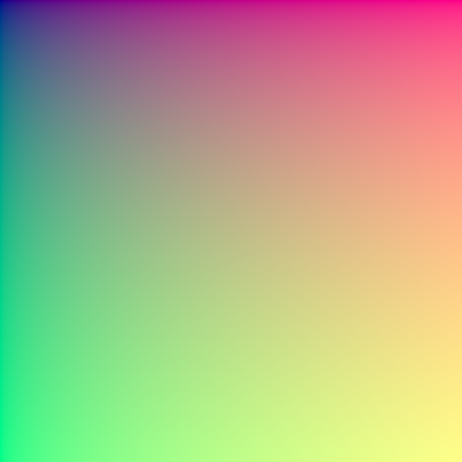
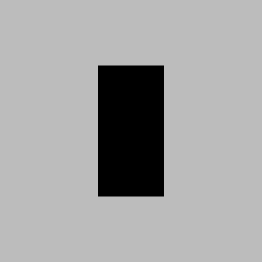
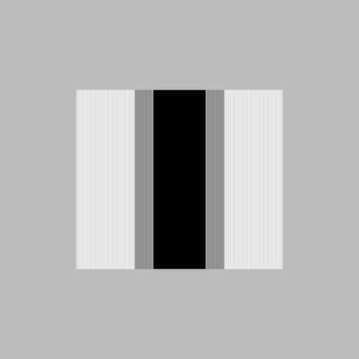

# Rust 光谱焦散渲染器

一个分阶段学习的 Rust CPU 离线光谱焦散渲染器。第一周目标是计算平行白光穿过三棱镜后落到地面的彩色能量分布，输出地面焦散俯视图。开发范围和验收标准见 [ROADMAP.md](ROADMAP.md)。

## 当前进度

**Day 1 已完成：输出链路与最小 Framebuffer。** 已实现：

- 二维 `Framebuffer`，用 `Vector3<f64>` 保存线性 XYZ，支持带边界检查的读写。
- XYZ → 线性 sRGB 矩阵转换，检查非有限值和计算溢出。
- 单通道线性 RGB → 显示 sRGB 编码，检查输入范围与非有限值。
- 线性 RGB 的显示范围裁剪、sRGB 8 位量化和 PNG 保存，自动创建输出目录。
- Day 1 曾通过 512×512 的 `output/test.png` 位置渐变图验证输出链路。
- Framebuffer、颜色转换与 PNG 读回测试。

**Day 2 已完成：光线、几何、最近交点与地面命中点灰度图。** `Ray::new` 检查输入并归一化方向，`at(distance)` 计算光线上的位置。`Ground`、`Triangle` 和 `Prism` 实现 `Hittable::intersect(&Ray) -> Option<Hit>`；`Scene::intersect` 遍历物体并返回最近交点。`render_ground_hits` 仅累计首先命中地面的光线，已保存 512×512 的 `output/ground_hits.png` 作为不透明遮挡示例。

**Day 3 已完成：固定折射率双界面折射与批量地面累积。** `scene::take_photon` 返回直接落地或通过玻璃两次折射后的地面落点；全反射、其他遮挡和未命中时返回 `None`。主程序用相同发射网格、总通量和曝光输出无三棱镜对照图及玻璃折射图。

**已接入双线性光子累积。** `utils::bilinear_weights` 根据落点的小数位置计算四个邻近像素及其权重，`caustics.rs` 将线性 XYZ 能量按权重分配；接收区域内的边缘落点也保留全部能量。这对应 Day 6 中的双线性 splat 子项。

阶段示例：

- Day 1 输出链路：[位置渐变测试图](output/test.png)。
- Day 2 几何验证：[地面命中点灰度图](output/ground_hits.png)。
- Day 3 对照：[无三棱镜](output/no_prism.png)、[固定折射率玻璃](output/refracted_hits.png)。







`Ray` 保存 `origin`、单位方向 `direction`、方向倒数缓存 `direction_inv`、时间参数 `time` 与距离区间 `t_min/t_max`。统一使用 `Ray::new(origin, direction, time)` 构造；Rust 不支持默认函数参数，因此普通光线显式传入 `0.0`。预留的 `t_min/t_max` 初始值为 `(0, f64::MAX)`，当前地面与三角形求交均不读取这两个字段。时间字段目前仅保存数值，不模拟传播时间，与 `at(distance)` 的距离参数独立。零方向分量的倒数为 `±∞`，这是允许的缓存值；后续包围盒求交需单独处理平行轴，避免 `0 × ∞` 产生 NaN。

`Hit` 是纯数据记录，保存 `coords`、`normal`、`distance`，以及可选的 `object_id/material_id`。`Hit::default()` 仅提供字段初始值：向量全零、距离为 `f64::MAX`、编号为 `None`。命中状态统一由 `Option<Hit>` 表达：`Some(hit)` 表示命中，`None` 表示未命中。位置计算、法线归一化、合法性检查和正反面判断均由求交算法或调用方负责。`distance` 是距离，与 `Ray.time` 的时间含义独立。

物体和材质关联用 `Option<usize>` 保存编号，`None` 对应 C++ 示例中的空指针；后续场景管理负责按编号访问实际对象。`Hittable::intersect(&self, ray: &Ray)` 只接收光线并返回 `Option<Hit>`，具体实现填写命中记录后返回 `Some(hit)`。

`Ground::new(height)` 创建无限水平面 `z = height`，第一周场景使用 `Ground::new(0.0)`。求交距离为 `(height - ray.origin.z) / ray.direction.z`，检查平行、非有限值、溢出及 `1e-6` 米的自相交阈值。地面支持双面求交，法线始终为 `(0, 0, 1)`，不会随入射方向翻转。`Ground` 只负责几何求交；`caustics::ground_to_pixel` 将交点映射为连续像素坐标，`utils::bilinear_weights` 计算四邻域权重，`Framebuffer::accumulate` 累加每份线性 XYZ 并拒绝非有限结果。

`Triangle::new(v0, v1, v2)` 保存三个顶点并缓存两条边和单位几何法线，拒绝非有限顶点、退化三角形及计算溢出。法线按 `(v1 - v0) × (v2 - v0)` 定向，顶点和缓存保持私有，保证二者一致。求交采用双面的 Möller–Trumbore 算法，求解 `origin + t * direction = v0 + u * edge1 + v * edge2`；交点需满足 `u >= 0`、`v >= 0`、`u + v <= 1`，以及正向距离 `distance > 1e-6` 米。算法填写 `Hit.coords/normal/distance`，其余预留字段沿用默认值，`Hit` 本身保持纯数据结构。

`Prism::new()` 将 6 个固定顶点组成 8 个三角形：两个三角形端面，加上三个各拆成两个三角形的矩形侧面。三角截面沿 y 轴从 `-1` 米拉伸至 `1` 米，底面为 `z = 1` 米，顶棱为 `z = 1.8` 米；所有三角形法线朝外。求交遍历所有面并取最近有效交点，支持从内部寻找出射面。

`scene::Scene::new(width, height)` 创建空场景，保存像素宽高、垂直视场角 `fov`（默认 90 度）、线性 RGB 背景色 `background_color`（默认黑色）与 `objects: Vec<Box<dyn Hittable>>`。`Box<dyn Hittable>` 让不同具体类型的物体保存在同一个集合中，通过 `add` 显式添加；返回的下标用于识别命中物体：

```rust
let mut scene = Scene::new(512, 512);
let prism_id = scene.add(Box::new(Prism::new().unwrap()));
let ground_id = scene.add(Box::new(Ground::new(0.0).unwrap()));
```

`Scene::intersect(&ray)` 返回最近的 `Option<Hit>`，并填写 `Hit.object_id`；`material_id` 仍为 `None`。物体编号是当前集合下标，查询期间不能重排集合。地面命中图使用宽高，保留的 `fov` 与 `background_color` 不参与当前光源追踪。

`take_photon(&scene, ray, prism_id, ground_id)` 按顺序执行首次求交、空气 → 玻璃折射、内部求交、玻璃 → 空气折射、最后一次地面求交。折射率固定为 `1.0` 与 `1.52`，界面起点沿法线偏移 `1e-5` 米，后续 Ray 保留原来的 `time`。入射使用朝外法线，出射使用取反后的法线。光线需从空气中出发，不处理已有玻璃内部起点。

## 运行

安装 Rust stable 后，在仓库根目录执行：

```bash
cargo run --release --locked
```

输出两张 512×512 PNG：`output/no_prism.png` 为无三棱镜对照，`output/refracted_hits.png` 为固定折射率玻璃的地面分布。默认从 `z = 3` 米的 4×4 米区域发射向下的平行光，方向为 `(0, 0, -1)`。每个发射小格均匀取 2×2 个中心样本，每张图共 1,048,576 条光线；不需要随机数，结果可复现。

接收区域为地面 `x、y ∈ [-2, 2)` 米，世界 +x 朝图片右侧，+y 朝图片上方。无三棱镜时像素线性亮度为 0.5，经过 XYZ → 线性 sRGB → sRGB 编码后为 `[188, 188, 188]`。加入玻璃后，透射落点向两侧移动，与直射光叠加形成更亮的区域；原来的部分区域没有光线落入。单条已知光线的地面落点从无玻璃时的 `(0.25, 0.2, 0)` 移至约 `(-0.7196, 0.2, 0)`。

在 `main.rs` 中修改 `samples_per_pixel_axis` 可以改变每格的采样数。两种光路复用相同的发射网格、像素映射和归一化：相对总通量固定为 `0.5 × 16`，每条光线的通量除以总光线数，再除以像素对应的地面面积后累积。增加采样数不会直接提高亮度；边界采样和全反射可能使落地通量有少量变化。这个灰度标尺没有实际光源功率单位。

双线性分配使用像素中心约定：地面归一化坐标为 `(u, v)` 时，连续图片坐标为 `x = u * width - 0.5`、`y = (1 - v) * height - 0.5`。整数坐标就是像素中心，保留小数后才计算相邻四点。以左上邻点为基准，小数部分为 `(dx, dy)`，四个权重依次为 `(1-dx)(1-dy)`、`dx(1-dy)`、`(1-dx)dy`、`dx*dy`，总和为 1。落在边缘半像素内时夹紧到边缘像素中心，避免向图外分配而损失能量；地面接收区域外的落点仍丢弃。

Day 3 的单条光线折射示例：

```bash
cargo run --locked --example refract_ray
```

示例按顺序执行空气 → 玻璃（`n = 1.52`）→ 空气 → 地面，打印入射点、玻璃内方向、出射点、出射方向和地面落点。`refract` 要求单位方向、单位法线，且法线朝向入射介质，所以出射调用使用 `-exit.normal`。界面处沿法线偏移 `1e-5` 米；全反射时终止并报告原因。`examples/refract_ray.rs` 保留了逐步展开的写法，方便对照 `take_photon` 阅读。

仅运行地面求交的 11 项测试：

```bash
cargo test --locked ground::tests
```

测试中的已知示例：从 `(0, 0, 2)` 向下发射，命中 `Ground::new(0.0)` 时距离为 `2` 米、交点为 `(0, 0, 0)`；斜射到 `z = 1` 的地面、从地面下方命中、平行与自相交等情况也有对应验证。

检查格式、运行测试与 Clippy：

```bash
cargo fmt --check
cargo test --locked
cargo clippy --locked --all-targets -- -D warnings
```

当前 84 项测试通过，严格 Clippy 通过。测试覆盖场景最近交点与物体编号、非正方形图片的坐标映射、区域边界与非有限输入、采样数量归一化、三棱镜遮挡、XYZ 累积溢出保护，以及灰度图的 PNG 读回。双线性测试覆盖已知小数位置的四点权重、像素中心、权重和、边缘与单像素尺寸、完整 XYZ 总能量守恒及遮挡边缘的平滑分配。折射测试覆盖法向与近法向入射、临界角两侧、全反射、法线方向、非法数值、Snell 定律和单条光线通过两个界面后落地。`take_photon` 测试还覆盖直接落地、未命中、三个传播阶段的其他遮挡、物体编号和添加顺序；批量渲染检查落点能量重分布、总能量上界与增加采样数后的尺度。

7 项三棱镜测试覆盖 8 个面的已知交点和朝外单位法线、最近面选择、棱边命中、内外求交、自相交与非有限光线；场景测试验证同一集合中不同物体的求交，以及改变添加顺序后仍选择最近交点。

单三角形的 15 项测试涵盖已知交点和法线、斜射、双面命中、顶点顺序、三条边内外与顶点、平行/共面、自相交、预留距离字段不影响命中、退化输入、非有限值、溢出及小尺寸三角形。

PNG 读回测试在独立临时目录中保存一张 3×2 小图，再解码检查尺寸、RGB8 像素格式和六个位置的红、绿、蓝、白、灰、黑颜色。线性灰色 `0.5` 必须保存为 `[188, 188, 188]`，用于检查 sRGB 编码和量化是否正确。测试成功后清理临时文件。

## 文件与颜色约定

- `src/framebuffer.rs`：二维图像缓冲，图片坐标通过 `y * width + x` 转成数组下标。
- `src/caustics.rs`：固定平行光网格、连续像素映射与归一化双线性灰度累积，支持直接命中和调用 `take_photon` 的折射光路。
- `src/utils.rs`：双线性四邻域与权重计算，含边缘夹紧和非法输入检查。
- `src/render.rs`：XYZ → 线性 sRGB → sRGB8 → PNG，以及颜色转换和 PNG 读回测试。
- `src/ray.rs`：Ray、方向归一化、沿光线取点及对应测试。
- `src/ground.rs`：可配置高度的无限地面、`Hittable` 求交实现及对应测试。
- `src/hit.rs`：求交结果的数据结构与字段默认值。
- `src/object.rs`：返回 `Option<Hit>` 的统一求交接口。
- `src/triangle.rs`：单三角形、几何法线、Möller–Trumbore 求交及测试。
- `src/prism.rs`：固定三棱镜的顶点与面定义、最近交点查询及测试。
- `src/scene.rs`：画面参数、物体集合、物体编号、最近交点、Snell 折射和 `take_photon` 双界面追踪。
- `src/lib.rs`：导出现有模块，供主程序和测试复用。
- `src/main.rs`：搭建玻璃与无玻璃对照场景，生成两张灰度 Framebuffer 并保存 PNG。
- `examples/refract_ray.rs`：单条光线进入三棱镜、内部传播、出射及落地的顺序示例。

XYZ 转换使用 D65 白点约定，参考白的 Y = 1。矩阵来自 [W3C CSS Color 4 的颜色转换示例](https://www.w3.org/TR/css-color-4/#color-conversion-code)，保留负值和大于 1 的线性 RGB 分量。

单通道编码公式来自 [ICC sRGB 编码登记表](https://registry.color.org/rgb-registry/srgb)。编码函数接收 `[0, 1]` 内的有限线性值，非法输入返回 `None`。PNG 导出时先将线性 RGB 逐通道裁剪到 `[0, 1]`，再编码、乘 255 并四舍五入为 `u8`。

## 当前简化与限制

- 地面为双面、无限大的水平面，默认场景约定高度为 `0`；图片仅记录 `x、y ∈ [-2, 2)` 米的有限区域。光线方向保持单位长度，返回的距离才表示米。
- 当前 `Ground` 和 `Triangle` 的几何求交仅要求有限的正向距离大于自相交阈值，不使用预留的 `ray.t_min/t_max`。改变光线方向时应重新构造 `Ray`，以归一化方向并同步 `direction_inv` 缓存。
- 求交忽略 `t <= 1e-6` 米的交点，以防止自相交；单位方向的 `|direction.z| <= 1e-12` 时视为平行。两个阈值分别作用于距离和方向分量。
- 三角形复用 `1e-6` 米的距离阈值；平行判断使用单位方向与单位法线的点积绝对值，阈值为 `1e-12`，与三角形面积独立。三棱镜采用固定顶点，棱边处返回最近面之一的法线；棱边没有唯一的几何法线。
- 固定曝光为 1.0；不会根据每张图片的最大值自动归一化。
- 显示范围采用逐通道裁剪，可能丢失高亮和色域外的颜色细节；Framebuffer 中的线性 XYZ 数据保留原值。
- 当前折射率固定为 `1.52`，灰色采用现有 D65 参考白缩放，尚未进行波长采样、色散或光谱积分。
- `take_photon` 最多经过两个玻璃界面；全反射直接终止，不继续内部反射。未计算 Fresnel 反射损失和吸收；超出接收区域的落点不写入图像。
- 当前光源高度、方向、发射区域和接收区域固定。双线性 splat 减轻了离散条纹，但规则网格仍可能留下采样纹理；较亮落点还可能被显示范围裁剪，没有按每张图的最大值自动归一化。
- 下一阶段为 Day 4 的波长与 Cauchy 色散模型。

使用 `nalgebra` 进行数学计算，`image` 编解码 PNG。`Cargo.lock` 随项目提交；`.gitignore` 仅放行 `output/test.png`、`output/ground_hits.png`、`output/no_prism.png`、`output/refracted_hits.png` 四张阶段示例，编译目录 `target/` 和其他生成文件继续忽略。运行默认命令会更新 Day 3 的两张对照图。
