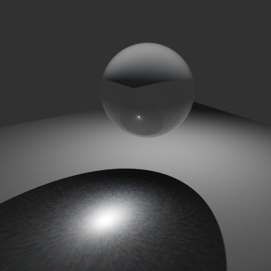
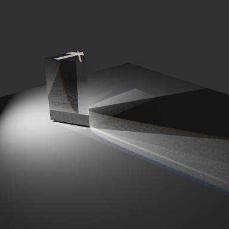
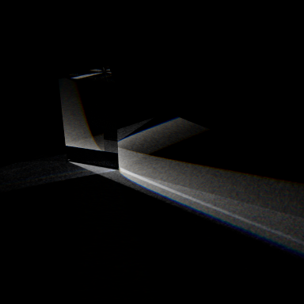
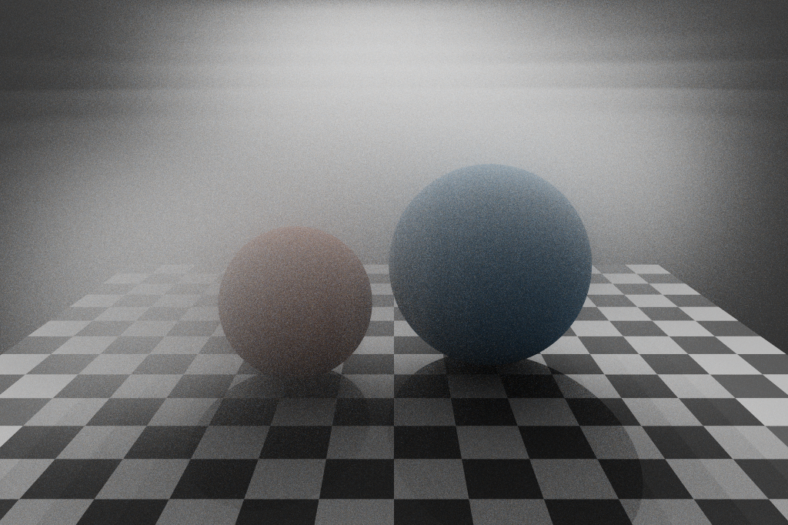
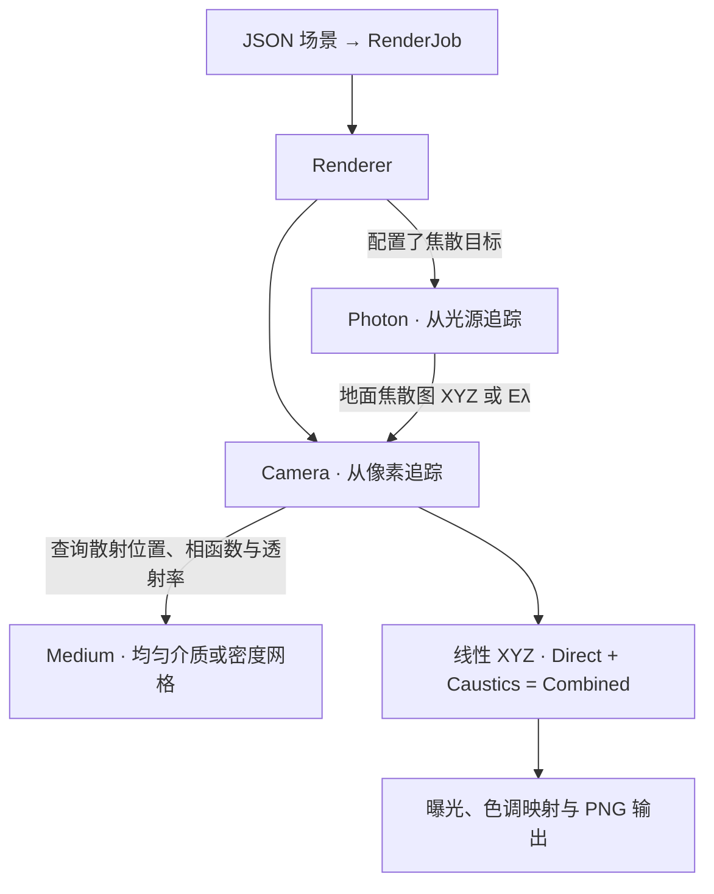

# Spectral Caustics Renderer

Rust · CPU Renderer · Spectral Rendering · Volume Scattering

## 项目介绍

这个 Rust CPU 离线渲染器可以模拟玻璃球聚光、棱镜色散和雾中的多次散射。你可以用 JSON 描述场景，选择 RGB 或逐波长相机，分别查看地面焦散和最终合成图。

## 效果展示

| 玻璃球 · Sphere | 直立棱镜 · Prism |
| :---: | :---: |
|  |  |
| **光谱焦散 · 棱镜的焦散分量** | **体渲染 · 非均匀网格雾** |
|  |  |

左下图单独显示右上图中的焦散贡献。右下图使用 24 × 20 × 16 的密度网格，允许每条相机路径最多散射 8 次。

## 核心功能

| 功能 | 可以观察或控制的效果 |
| --- | --- |
| RGB / Hero / Packet 相机 | RGB 相机追踪三个颜色通道。Hero 为每条路径采样一个波长。Packet 的四个波长共享一条主射线，进入玻璃后可沿不同方向传播。 |
| Forward Photon Tracing | 从平行光或圆盘面光源发射光子，追踪玻璃界面的反射与折射，把落到地面的通量累积成焦散图。 |
| BSDF / Fresnel / MIS | 用 BSDF 描述漫反射、镜面和粗糙金属，用 Fresnel 决定玻璃界面的反射与透射概率。对 HDRI 环境照明，MIS 组合材质与环境两种方向采样。 |
| Homogeneous Medium | 均匀雾支持吸收和多次体散射。Henyey–Greenstein 相函数的参数 `g` 可按波长配置，以控制各波长的散射方向分布。 |
| Heterogeneous Grid Medium | 用体素密度描述分层或团块状的雾。DDA 逐格累积光学厚度以计算透射率，Delta Tracking 用分块消光上界（Local Majorants）采样散射位置。 |

## 快速开始

先安装包含 Cargo 的 Rust 稳定工具链。本项目使用 Rust 2024 edition。已有 Rust 环境可直接从克隆仓库开始。[Rust 安装说明](https://www.rust-lang.org/tools/install)

```sh
git clone https://github.com/woel0721/spectral-caustics.git
cd spectral-caustics
cargo build --release --locked
cargo run --release --locked -- configs/grid_fog.json
```

这个 192 × 128 的示例会生成两颗球置于非均匀雾中的图像。打开 `output/grid_fog/camera_combined.png` 查看结果。同目录的 `camera_direct.png` 包含表面与体散射的光照贡献，`camera_caustics.png` 单独保存地面焦散。雾示例没有焦散目标，因此焦散分量为黑色。换成棱镜场景即可看到三张图的区别。

| 想尝试的场景 | 替换命令末尾的配置文件 |
| --- | --- |
| 圆盘面光源下的玻璃球聚光 | [configs/sphere_forward_preview.json](configs/sphere_forward_preview.json) |
| 圆盘面光源下的棱镜色散与地面焦散 | [configs/vertical_prism_forward_preview.json](configs/vertical_prism_forward_preview.json) |
| 比较均匀雾与网格雾 | [configs/homogeneous_fog.json](configs/homogeneous_fog.json) · [configs/grid_fog.json](configs/grid_fog.json) |
| 在雾中渲染内部真空的玻璃球 | [configs/sphere_medium_interface.json](configs/sphere_medium_interface.json) |

**第一次改配置**可以复制一份 `grid_fog.json`，把 `scene.max_volume_scatters` 从 `8` 改为 `0`，再将 `render.output_path` 改到另一个目录。用同一条命令运行新文件，即可对照只保留消光和允许多次散射的结果。配置中的相对路径从启动目录解析，请在仓库根目录运行。

要比较光谱采样，在棱镜配置中保持 `render.camera_mode` 为 `"spectral"`，将 `render.spectral_packet_size` 设为 `1`（Hero）或 `4`（Packet）。`render.camera_spp` 是每像素的光谱路径总数，四波长模式要求它能被 4 整除。

## 架构概览



Renderer 调度光子和相机两部分。相机在符合条件的地面交点读取焦散图，并通过 Medium 接口处理穿过雾的射线段。Direct 与 Caustics 在线性 XYZ 空间相加得到 Combined，随后才做色调映射并保存 PNG。

## 技术文档

| 想深入了解 | 阅读入口 |
| --- | --- |
| 从 JSON 到成图的执行流程、Rust API 与模块职责 | [代码入口与调用示例](docs/rendering_guide.md#从入口阅读代码) · [架构说明](.agents/architecture.md) |
| 相机与光子的权重、MIS、波长积分 | [传输约定](docs/rendering_guide.md#传输约定) |
| 如何配置雾、比较散射阶数，以及网格内如何采样 | [均匀介质与多次体散射](docs/rendering_guide.md#均匀介质与多次体散射) · [非均匀密度网格](docs/rendering_guide.md#非均匀密度网格) |
| 如何给玻璃设置内部真空、均匀介质或网格介质 | [玻璃介质界面](docs/rendering_guide.md#玻璃介质界面) |
| 分块上界在均匀、稀疏和尖峰密度场中的耗时与内存 | [局部 Majorant 基准与测量条件](docs/medium_majorant_benchmark.md) |
| 配置默认值、路径诊断和可运行的实验 | [配置与 Diagnostics](docs/rendering_guide.md#配置与-diagnostics) · [示例与验证](docs/rendering_guide.md#示例与验证) |

## 当前限制

- **焦散**仅支持单个玻璃球或棱镜在有限地面接收区内形成的焦散。环境光不生成焦散，玻璃对阴影射线仍按完全遮挡处理。
- **体渲染**使用轴对齐盒内的介质，一个封闭玻璃可以指定独立内部介质。相机体散射预算为 `scene.max_volume_scatters`。`render.photon_max_volume_scatters` 默认 0，设为正数后，焦散图会纳入首次玻璃反射或折射后发生体散射并到达地面接收区的光子通量。
- **材质与几何**方面，GGX 粗糙金属仅支持 RGB 相机。玻璃界面使用空气与玻璃两侧的折射率，暂不支持嵌套介质。
- **运行方式**为 CPU 离线渲染，路径深度有限。完整支持范围见[当前实现与开发边界](ROADMAP.md)。
