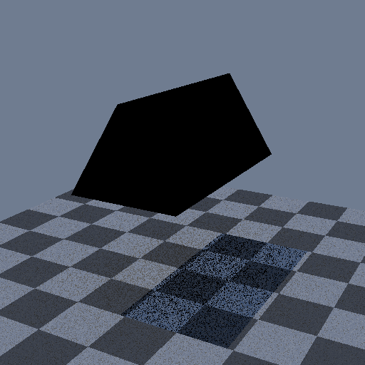
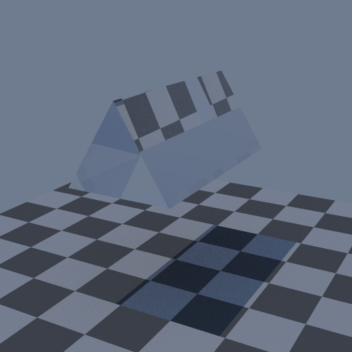
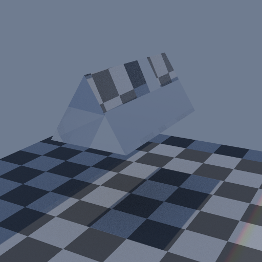
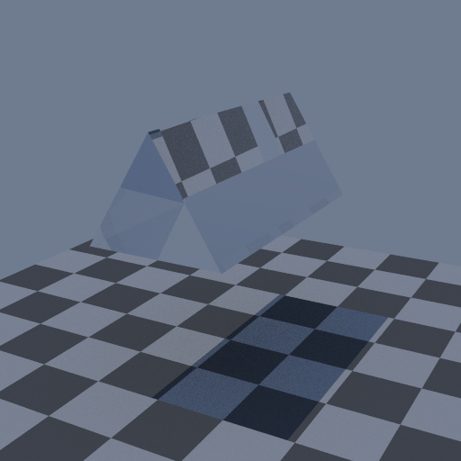
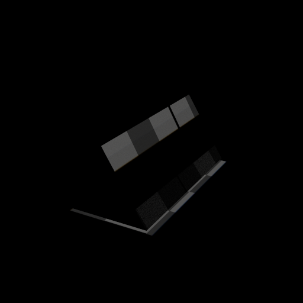
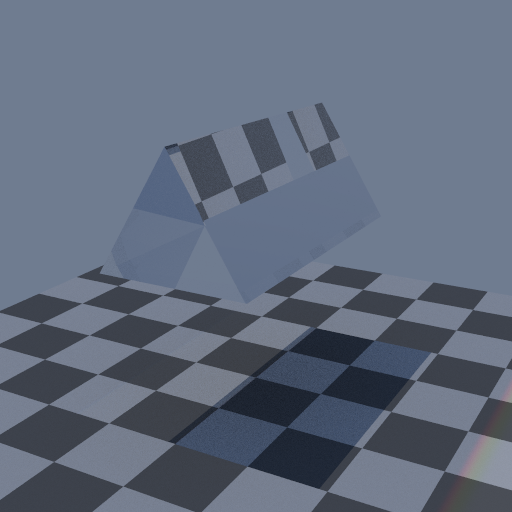

# Rust 光谱焦散渲染器

一个分阶段学习的 Rust CPU 离线光谱焦散渲染器。第一周目标是计算平行白光穿过三棱镜后落到地面的彩色能量分布，输出地面焦散俯视图。开发范围和验收标准见 [ROADMAP.md](ROADMAP.md)。

## 当前进度

**Day 1 已完成：输出链路与最小 Framebuffer。** 已实现：

- 二维 `Framebuffer`，用 `Vector3<f64>` 保存线性 XYZ，支持带边界检查的读写。
- XYZ → 线性 sRGB 矩阵转换，检查非有限值和计算溢出。
- 单通道线性 RGB → 显示 sRGB 编码，检查输入范围与非有限值。
- 线性 RGB 的显示范围裁剪、sRGB 8 位量化和 PNG 保存，自动创建输出目录。
- Day 1 曾通过 512×512 的 `output/test.png` 位置渐变图验证输出链路。
- Framebuffer、颜色转换与 PNG 读回测试。

**Day 2 已完成：光线、几何、最近交点与地面命中点灰度图。** `Ray::new` 检查输入并归一化方向，`at(distance)` 计算光线上的位置。`Ground`、`Triangle` 和 `Prism` 实现 `Hittable::intersect(&Ray) -> Option<Hit>`；`Scene::intersect` 遍历物体并返回最近交点。`render_ground_hits` 仅累计首先命中地面的光线，已保存 512×512 的 `output/ground_hits.png` 作为不透明遮挡示例。

**Day 3 已完成：固定折射率双界面折射与批量地面累积。** `scene::take_photon` 返回直接落地或通过玻璃两次折射后的地面落点；全反射、其他遮挡和未命中时返回 `None`。主程序用相同发射网格、总通量和曝光输出无三棱镜对照图及玻璃折射图。

**Day 4 已实现 Cauchy 及折射率模式。** `scene::refractive_index(wavelength_nm, mode)` 返回 `Option<f64>`：`IorMode::Constant` 忽略波长并使用 `1.52`，`IorMode::Dispersion` 要求有效波长并按 Cauchy 计算。`take_photon` 接收返回折射率的闭包。`render_refracted_ground_hits` 统一接收波长数组和 `IorMode`，固定折射率对照与三波长灰度调试共用这一个入口。

**Day 5 已完成：光谱积分与彩色 PNG 输出。** `spectrum` 导入可追溯的 CIE 1931 2° CMF 和 D65 相对 SPD，支持非整数波长的线性插值，按 `k × S(λ) × CMF(λ) × Δλ` 返回单个波长的线性 XYZ。`render_spectral_caustics` 独立发射与追踪光线，将 41 个波长的光子贡献直接双线性累积到一张 XYZ 图。`main` 以相同采样和曝光输出彩色 `output/caustics.png` 及固定折射率白光对照 `output/constant_ior.png`。数据、许可和校验和见 [assets/color/README.md](assets/color/README.md)。

**V0.4 已接入相机单次直接光照和硬阴影。** `render_camera_lit` 从相机生成主光线，按最近命中的材质和 shadow ray 可见性计算 `L_o = V f_r L_light max(n · wi, 0)`，经线性 RGB→XYZ 写入 Framebuffer，再复用曝光和 sRGB 输出 `output/camera_lit.png`。

**已实现玻璃 Fresnel 离散事件采样、有界相机路径、SPP 与子像素抖动。** `Material::sample` 统一返回 `Option<MaterialSample>`，Lambertian 返回 `Continuous { wi }`，Dielectric 返回 `Glass(GlassSample { wi, event, probability, weight })`；`GlassEvent` 区分反射与透射。`render_camera_glass` 负责像素内随机位置的多样本平均，`trace_camera_path` 负责单条最多八次散射的路径；运行 `camera_glass` 示例可生成独立的相机玻璃图，默认 64 SPP。

**已接入地面光谱辐照度与相机画面。** `camera_glass_with_ground` 示例先由光源追踪得到未曝光的地面 XYZ 辐照度，再通过 `render_camera_glass_with_ground` 追踪相机路径；命中中性灰地面时双线性读取 E，并按 `L_o = E rho / π` 着色，输出 `output/camera_glass_with_ground.png`。

**V0.4 阶段 14 已分离直射与焦散。** `camera_direct_caustics` 示例只追踪一批光源样本，将解析太阳直射与焦散专用图相加；普通地面不再受 receiver 边界裁切，玻璃硬阴影只作用于直射。旧输出入口继续保留。

**V0.4 阶段 15 已加入光子 Fresnel 通量衰减。** `PhotonLanding` 保存落点和 `(1-F_enter)*(1-F_exit)`；固定模式与色散模式的光谱图、灰度能量对照在落地累积时使用此权重。直射保持权重 1；暂不追踪其他反射光路，也不使用相机 radiance 的折射率平方项。

**V0.4 阶段 19 已统一环境模型并接入 Monte Carlo 环境照明。** `Environment::radiance(direction)` 同时服务相机背景和物体照明，只保留地平线色与天顶色。积分器复用 Lambertian 余弦加权采样，按可见性累计环境贡献；环境中不包含太阳。

**V0.4 阶段 17 已加入地面棋盘格并调整构图。** 默认太阳传播方向改为 `[0.45, 0, -1]`，相机位置 `[2.5, -4.5, 2.6]`、目标 `[0, 0, 0.9]`、垂直 FOV `35°`。棋盘格按地面世界 x/y 坐标生成，每格 0.5 米，只在相机着色时调制反射率。

**V0.4 阶段 18 已将配置场景的地面限制为有限矩形。** 默认在 receiver 四边各外扩 `0.5 m`，地面范围为 `[-2.5,2.5] × [-2.5,2.5]`，略大于 receiver 的 `[-2,2] × [-2,2]`。超出地面边界的相机射线看到天空。

**已接入双线性光子累积。** `render::utils::bilinear_weights` 根据落点的小数位置计算四个邻近像素及其权重，`caustics.rs` 将线性 XYZ 能量按权重分配；接收区域内的边缘落点也保留全部能量。这对应 Day 6 中的双线性 splat 子项。

**发射采用分层随机采样。** 每个小格各发射一条光线，x、y 分别使用独立的随机偏移。`StdRng` 使用固定种子 `42`；每次渲染都重新初始化，因此无三棱镜和折射图共享同一组发射位置，命中或丢弃光线不会改变后续采样序列。

阶段示例：

- Day 1 输出链路：[位置渐变测试图](output/test.png)。
- Day 2 几何验证：[地面命中点灰度图](output/ground_hits.png)。
- Day 3 对照：[无三棱镜](output/no_prism.png)、[固定折射率玻璃](output/refracted_hits.png)。
- Day 4 落点调试：[450 nm](output/wavelength_450nm.png)、[550 nm](output/wavelength_550nm.png)、[650 nm](output/wavelength_650nm.png)。
- Day 5 光谱积分：[色散彩色焦散](output/caustics.png)、[固定折射率白光对照](output/constant_ior.png)。


当前三棱镜和光源设置主要在光斑边缘形成窄色带；固定折射率对照保持中性灰白。两张图共用种子 42、4×4 空间分层采样、41 个波长和曝光 1.0。


`Ray` 保存 `origin`、单位方向 `direction`、方向倒数缓存 `direction_inv` 与距离区间 `t_min/t_max`。统一使用 `Ray::new(origin, direction)` 构造，检查有限起点和有效方向，再归一化方向并计算倒数缓存。当前场景为静态，没有运动模糊，已删除未参与计算的时间字段。`at(distance)` 的参数表示沿光线前进的距离（米）。预留的 `t_min/t_max` 初始值为 `(0, f64::MAX)`，当前地面与三角形求交均不读取这两个字段。零方向分量的倒数为 `±∞`，这是允许的缓存值；后续包围盒求交需单独处理平行轴，避免 `0 × ∞` 产生 NaN。

`Hit` 是纯数据记录，保存 `coords`、`normal`、`distance`，以及可选的 `object_id/material_id`。`Hit::default()` 仅提供字段初始值：向量全零、距离为 `f64::MAX`、编号为 `None`。命中状态统一由 `Option<Hit>` 表达：`Some(hit)` 表示命中，`None` 表示未命中。位置计算、法线归一化、合法性检查和正反面判断均由求交算法或调用方负责。`distance` 是从光线起点到交点的距离，单位为米。

物体和材质关联用 `Option<usize>` 保存编号，`None` 对应 C++ 示例中的空指针；后续场景管理负责按编号访问实际对象。`Hittable::intersect(&self, ray: &Ray)` 只接收光线并返回 `Option<Hit>`，具体实现填写命中记录后返回 `Some(hit)`。

`Ground::with_bounds(height, min, max)` 创建有限水平矩形 `z = height`，配置场景使用此接口；`Ground::new(height)` 保留创建无限平面的几何示例/测试用途。求交距离为 `(height - ray.origin.z) / ray.direction.z`，检查平行、非有限值、溢出及 `1e-6` 米的自相交阈值，再按交点世界 x/y 坐标裁切矩形边界。地面支持双面求交，法线始终为 `(0, 0, 1)`，不会随入射方向翻转。`Ground` 只负责几何求交；`render::caustics::ground_to_pixel` 将交点映射为连续像素坐标，`render::utils::bilinear_weights` 计算四邻域权重，`Framebuffer::accumulate` 累加每份线性 XYZ 并拒绝非有限结果。

`Triangle::new(v0, v1, v2)` 保存三个顶点并缓存两条边和单位几何法线，拒绝非有限顶点、退化三角形及计算溢出。法线按 `(v1 - v0) × (v2 - v0)` 定向，顶点和缓存保持私有，保证二者一致。求交采用双面的 Möller–Trumbore 算法，求解 `origin + t * direction = v0 + u * edge1 + v * edge2`；交点需满足 `u >= 0`、`v >= 0`、`u + v <= 1`，以及正向距离 `distance > 1e-6` 米。算法填写 `Hit.coords/normal/distance`，其余预留字段沿用默认值，`Hit` 本身保持纯数据结构。

`Prism::new()` 使用默认六顶点，`Prism::from_vertices` 使用配置的六顶点并检查凸性、退化和法线方向；均组成 8 个三角形：两个三角形端面，加上三个各拆成两个三角形的矩形侧面。三角截面沿 y 轴从 `-1` 米拉伸至 `1` 米，底面为 `z = 1` 米，顶棱为 `z = 1.8` 米；所有三角形法线朝外。求交遍历所有面并取最近有效交点，支持从内部寻找出射面。

`scene::Scene::new()` 创建空场景，保存 `objects: Vec<SceneObject>`、运行时相机、光源、地面接收区域与背景色。每个 `SceneObject` 绑定 `geometry: Box<dyn Hittable>` 与可选的材质编号，材质由场景的 `Vec<Box<dyn Material>>` 持有。图片宽高归 `RenderSetting` 和运行时 `Render` 管理。`Scene::from_config(&config.scene)` 根据 JSON 中的类型和顶点构建物体并记录地面/三棱镜编号。`Box<dyn Hittable>` 让不同具体类型的几何保存在同一个集合中，通过 `add` 显式添加；返回的下标用于识别命中物体：

```rust
let mut scene = Scene::new();
let prism_id = scene.add(Box::new(Prism::new().unwrap()));
let ground_id = scene.add(Box::new(Ground::new(0.0).unwrap()));
```

`Scene::intersect(&ray)` 返回最近的 `Option<Hit>`，并填写 `Hit.object_id`。配置构建的物体还会填写 `Hit.material_id`，通过 `Scene::material(id)` 查询对应材质；手动只调用 `Scene::add` 添加几何时，材质编号仍为 `None`。物体编号是当前集合下标，查询期间不能重排集合。渲染入口从 `RenderSetting` 获取宽高，`camera` 与 `background_color` 不参与当前光源追踪。

`take_photon(&scene, ray, prism_id, ground_id, glass_ior)` 按顺序执行首次求交、空气 → 玻璃折射、内部求交、玻璃 → 空气折射、最后一次地面求交。`glass_ior` 类型为 `impl FnOnce() -> Option<f64>`，通过 `||` 创建无参数闭包，并捕获当前波长和模式。函数只调用一次闭包，将得到的玻璃折射率用于两个界面；闭包返回 `None`、非正或非有限折射率时返回 `None`。空气折射率固定为 `1.0`。界面起点沿法线偏移 `1e-5` 米，后续 Ray 由偏移起点和折射方向构造。入射使用朝外法线，出射使用取反后的法线。光线需从空气中出发，不处理已有玻璃内部起点。

阶段 15 新增 `take_photon_landing(...) -> Option<PhotonLanding>`，参数与旧接口一致，额外返回正向通量权重。旧 `take_photon()` 将该结果映射为坐标，继续用于几何落点查询；能量累积应使用带权重的接口。内部 `take_photon_from_hit` 也返回 `PhotonLanding`，继续复用批量追踪已有的首次交点。

`refractive_index(None, IorMode::Constant)` 返回 `Some(1.52)`，传入其他波长也不改变该模式的结果；`refractive_index(Some(wavelength_nm), IorMode::Dispersion)` 使用 `n = 1.5046 + 0.0042 / (wavelength_nm / 1000)²`，除以 1000 将 nm 转为 μm。参数来自路线图，仅用于演示，不代表特定真实玻璃。色散模式下缺少波长、波长非正或非有限、计算溢出时返回 `None`。450 nm 时折射率约为 `1.52534`，650 nm 时约为 `1.51454`；同一条从 `(0.25, 0.2, 3)` 向下发射的光线分别落在约 `(-0.73212, 0.2, 0)` 与 `(-0.70696, 0.2, 0)`。调用示例：

```rust
use spectral_caustics::{
    optics::iormode::IorMode,
    scene::{refractive_index, take_photon},
};

let wavelength_nm = 450.0;
let mode = IorMode::Dispersion;
let position = take_photon(&scene, ray, prism_id, ground_id, || {
    refractive_index(Some(wavelength_nm), mode)
});
// 也可以直接提供自定义固定折射率：
let position = take_photon(&scene, ray, prism_id, ground_id, || Some(1.52));
```

批量落点调试由 `Render::refracted_hits(&scene, wavelengths_nm, mode)` 调用同一套配置化追踪入口，返回 `[Framebuffer; N]`。顺序与输入一致，总通量在 N 张图之间等分。固定模式通常传 `[None]`；色散模式要求有效的 `Some(波长 nm)`：

```rust
use spectral_caustics::{config::Config, render::Render, scene::Scene,
    render::caustics::DEBUG_WAVELENGTHS_NM, optics::iormode::IorMode};

let config = Config::load("configs/default.json")?;
let scene = Scene::from_config(&config.scene)?;
let renderer = Render::new(config.render.clone())?;
let [constant] = renderer.refracted_hits(&scene, [None], IorMode::Constant)?;
let wavelengths = renderer.refracted_hits(
    &scene, DEBUG_WAVELENGTHS_NM.map(Some), IorMode::Dispersion,
)?;
```

## 波长到 XYZ

`optics::spectrum::cie_xyz(wavelength_nm)` 查询颜色匹配函数，`d65_spd(wavelength_nm)` 查询光源功率密度。`wavelength_to_xyz(wavelength_nm, spectral_power, delta_lambda_nm, k)` 将二者与积分宽度相乘，返回 `Option<Vector3<f64>>`。所有波长共用一个 k，不能逐个波长归一化。对于 D65，取 `k = 1 / Σ[S(λ)ȳ(λ)Δλ]`，使未经过滤的完整白光 Y = 1；使用相对 Y = 1 而不是 Y = 100，与当前 PNG 输出链路一致。

```rust
use spectral_caustics::optics::spectrum::{d65_normalization, d65_spd, wavelength_to_xyz};

// 380–780 nm，每 10 nm 一点；梯形积分在两个端点使用半权重。
let samples: Vec<(f64, f64)> = (380..=780)
    .step_by(10)
    .map(|nm| (nm as f64, if nm == 380 || nm == 780 { 5.0 } else { 10.0 }))
    .collect();
let k = d65_normalization(&samples).unwrap();

// 550 nm 这一项的 XYZ 贡献；后续按各自光路落点与空间通量权重累积。
let xyz_i = wavelength_to_xyz(550.0, d65_spd(550.0).unwrap(), 10.0, k).unwrap();
```

`Δλ` 已包含积分宽度，不再除以波长样本数；空间发射数的通量归一化仍由渲染层负责。k 在追踪前按完整光源计算，全反射或未落地的波长不会使剩余通量重新归一化。这里实现离散积分；随机波长采样的 `1 / p(λ)` 权重仍需在接入该采样方式时处理。

两张表均使用原始 1 nm 数据，表内线性插值，表外按官方元数据返回零；非正或非有限波长返回 `None`。功率或 k 为负、积分宽度非正、非有限输入及计算溢出也返回 `None`。

`render::caustics::render_spectral_caustics` 独立执行分层发射和光谱追踪，不调用灰度渲染入口。根据 `render.wavelength_min_nm/max_nm/step_nm` 建立梯形积分节点（默认 380–780 nm 的 41 点，末段不足步长时使用实际宽度），在追踪前将 `k × S(λ) × CMF(λ) × Δλ × 空间通量权重` 求和为完整白光贡献 `direct_xyz`。`Constant` 只计算一次玻璃折射率 `1.52`，不保存逐波长光路贡献；`Dispersion` 才缓存各波长的折射率和 XYZ。所有波长共用种子 42 和相同空间发射位置；每条空间光线只查询一次首次最近交点。直接命中地面时，用完整白光贡献做一次双线性 splat；命中三棱镜时，固定模式只追踪一次双界面折射并用 `direct_xyz` 累积一次，色散模式才逐波长继续折射并累积各自的 XYZ；其他遮挡或未命中直接丢弃。各并行块将所有波长合成到自己的 XYZ 图，最后合并为一张图，不生成 41 张逐波长中间灰度图，也不需要除以或乘回 41。

阶段 15 起，所有折射贡献在 splat 前乘 `landing.weight`；完整 D65 归一化、空间发射权重和接收像素面积保持原来的定义。灰度对照也乘同样的透射比例，因此可继续作为逐波长能量参考。

光谱渲染使用 Rayon 线程池：发射采样行按 `render.max_spectral_blocks` 分块（默认最多 16 块），每块独立累积到自己的 Framebuffer，全部计算完成后按块编号依次合并线性 XYZ。各块使用全图光线数归一化，合并时直接相加，不再除以块数或线程数；追踪期间没有共享可写的像素或 RNG。512×512 时一张 XYZ 图为 6 MiB，16 张局部图加最终图的像素缓冲峰值约为 102 MiB。灰度调试入口仍按原来的串行流程执行。

为保留原版采样位置，光谱分块显式使用 `rand_chacha::ChaCha12Rng`，通过 [`set_word_pos`](https://docs.rs/rand_chacha/0.9.0/rand_chacha/struct.ChaCha12Rng.html#method.set_word_pos) 直接定位各块的随机序列起点，不再串行生成并丢弃前面的随机数。当前锁定的 `rand 0.9.5` 的 `StdRng` 使用同一算法；每条光线的 X/Y 两个 `f64` 偏移消耗四个 `u32` word，因此块起点为 `start_row × samples_x × 4`。任务只生成自己实际使用的随机数，不保存全图的 Ray 或随机偏移。分块边界和合并顺序与线程数无关，避免并行浮点归约的调度顺序影响输出。不同线程数的 XYZ 结果应完全一致；与旧串行版相比，加法分组改变可能产生末位舍入差异。

这里的“只算一次”针对同一条空间光线的波长分量；不同发射位置仍独立采样。完整白光使用当前 D65/CIE 积分的 XYZ 总和，保留 `Δλ` 和空间权重，不能取单个波长的贡献代替。固定模式也保留这一步渲染前的光谱积分，只省去每条空间光线内重复的波长追踪和累积；不同空间光线落在同一像素时仍需累加。`take_photon` 保留原有单光线接口，批量追踪通过内部的 `take_photon_from_hit` 复用首次交点。灰度调试也复用首次交点；固定模式只追踪一次玻璃路径，并把同一落点交给 N 张图，但每张图仍分别累积 `1/N` 通量。合并 XYZ 加法的顺序改变后，浮点结果可能存在末位舍入差异。

```rust
use spectral_caustics::{config::Config, render::Render, scene::Scene};

let config = Config::load("configs/default.json")?;
let scene = Scene::from_config(&config.scene)?;
let renderer = Render::new(config.render.clone())?;
let framebuffer = renderer.render(&scene)?;
renderer.save(&framebuffer, &config.render.output_path)?;
// renderer.render_mode(&scene, IorMode::Constant) 可生成同配置的固定折射率对照。
```

完整 D65 光谱在追踪前计算统一 k；遮挡、全反射及接收区外的通量直接丢弃。增加空间采样数不会直接增加亮度。固定折射率模式下所有波长路径相同，默认完整 D65 积分后保持中性白；色散模式下各波长落点不同，合成后才呈现空间颜色差异。

## JSON 配置层

`configs/default.json` 统一保存两份纯数据描述，默认值与当前示例场景和主要渲染参数一致：

| 配置 | 主要字段 |
| --- | --- |
| `RenderSetting`，JSON 中的 `render` | 图片宽高、空间采样数、折射率模式、波长范围/步长、曝光、种子、线程数、采样块数上限、主图输出路径 |
| `SceneConfig`，JSON 中的 `scene` | 相机 `camera`、含材质的物体描述、平行光源、地面接收范围、天空 `environment` 与备用背景色 |

`ObjectConfig` 用 `type` 区分 `prism` 和 `ground`：三棱镜保存六个原始顶点，地面保存高度，各自在 `material` 中保存材质描述；它们不是 `Box<dyn Hittable>`，也不保存法线、求交函数或渲染缓冲。长度以米表示，波长字段显式使用 nm。光源 `total_flux = 8.0` 是原有 `0.5 × 16` 的相对总通量，没有新增瓦特单位约定。

材质由 `MaterialConfig` 描述，用 `type` 区分 `lambertian` 与 `dielectric`。例如地面的完整描述为：

```json
{
  "type": "ground",
  "height_m": 0.0,
  "material": {
    "type": "lambertian",
    "albedo": [0.8, 0.8, 0.8]
  }
}
```

默认三棱镜使用 `"material": { "type": "dielectric", "ior": 1.52 }`。`albedo` 是线性 RGB 反射率，三个分量必须有限且位于 `[0, 1]`；`ior` 是无量纲折射率，必须有限且大于零。材质类型、字段类型、必需参数与未知字段都会校验，非有限值不能写入 JSON 或覆盖已有文件。旧 JSON 省略整个 `material` 时，三棱镜补默认玻璃材质，地面补 `[0.8, 0.8, 0.8]` 的漫反射材质。

`MaterialConfig` 保留可序列化的 enum；`material::from_config` 将它转换为 `Box<dyn Material>`，具体实现为 `material::lambertian::Lambertian` 或 `material::dielectric::Dielectric`，其中 `albedo` 变为 `Vector3<f64>`。两种运行时材质都使用 `new(...) -> Result<_, String>` 校验参数。最近命中的材质可这样求值：

```rust
use spectral_caustics::material::{BsdfValue, EvaluateMode};

if let Some(hit) = scene.intersect(&ray) {
    if let Some(material) = hit.material_id.and_then(|id| scene.material(id)) {
        let wi = -scene.light.direction; // 从交点指向光源
        let wo = -ray.direction;        // 从交点指向观察者
        let f_rgb = material.evaluate(wi, wo, hit.normal, EvaluateMode::Rgb);
        let f_spectral = material.evaluate(
            wi, wo, hit.normal, EvaluateMode::Spectral { wavelength_nm: 550.0 },
        );
        // f_rgb 为 BsdfValue::Rgb(线性 RGB 向量)。
        // f_spectral 为 BsdfValue::Spectral(550 nm 的标量 BSDF rho(λ) / π)。
        // 光照积分仍需乘该波长的入射辐亮度、余弦项和采样权重。
    }
}
```

`Material: Send + Sync` 统一使用 `evaluate(wi, wo, normal, mode) -> BsdfValue`。`EvaluateMode::Rgb` 返回 `BsdfValue::Rgb(Vector3<f64>)`，保存线性 RGB 的 BSDF 值（sr⁻¹）；`EvaluateMode::Spectral { wavelength_nm }` 返回 `BsdfValue::Spectral(f64)`，保存单波长标量。波长只随光谱模式传入，调用方通过 `match` 或 `if let` 取出对应数值；原有两个求值方法已合并。结果不包含余弦、PDF、曝光或显示编码。`wi` 和 `wo` 都从交点向外指；内部归一化三个向量，零向量、非有限值和模长溢出安全返回对应模式的零值。

`material::to_world(local, normal) -> Option<Vector3<f64>>` 将局部方向转换为世界方向。局部 +Z 对应归一化后的法线 n，局部 X/Y 对应函数构造的切线 t 和副切线 b，满足 `t × b = n`；结果为 `local.x × t + local.y × b + local.z × n`。仅给定法线时，绕法线的切线朝向由辅助坐标轴确定；法线为世界 +Z 时变换为恒等映射。函数保留向量长度和局部 z 的正负，零局部向量映射为零，不加交点位置，也不额外归一化局部方向。非有限局部分量、无法归一化的法线或计算溢出返回 `None`。例如：

```rust
let world_direction = spectral_caustics::material::to_world(
    nalgebra::Vector3::z(), // 局部方向 (0, 0, 1)
    hit.normal,
); // Some(归一化后的 hit.normal)
```

光谱模式下，Lambertian 使用已有的 PBRT/Smits 反射基谱将线性 RGB albedo 重建为 `rho(λ)`，仅返回 `f_r(λ) = rho(λ) / π`。它不乘 CIE 匹配函数、光源 SPD、余弦、PDF、归一化因子 k 或波长积分权重。积分器保持标量光谱吞吐量，在最终转换为 XYZ 时再乘 `CMF(λ)`；离散积分还需乘 `k × L_i(λ) × cosθ × Δλ`，随机波长采样则使用相应的 `1/p(λ)` 权重。非法方向、背面、切线，以及非正或非有限波长返回 `BsdfValue::Spectral(0.0)`；理想 Dielectric 的光谱普通求值也返回该零值。该模式独立于 CIE 表的波长范围，有效波长沿用反射基谱的端点延拓。

`Material` 的方向采样接口为：

```rust
fn sample(&self, wo: Vector3<f64>, normal: Vector3<f64>, rng: &mut dyn rand::RngCore)
    -> Option<MaterialSample>;
fn pdf(&self, wi: Vector3<f64>, wo: Vector3<f64>, normal: Vector3<f64>) -> f64;
```

`wo` 是已知的、从交点指向上一顶点/观察者的方向；`sample` 返回新的单位世界方向 `wi`，从交点指向下一顶点。两者与 BSDF 求值的方向约定相同。Lambertian 使用 [余弦加权半球采样](https://www.pbr-book.org/4ed/Sampling_Algorithms/Sampling_Multidimensional_Functions#Cosine-WeightedHemisphereSampling)：取两个均匀随机数 `u, v ∈ [0, 1)`，构造局部方向 `(sqrt(u) cos(2πv), sqrt(u) sin(2πv), sqrt(1-u))`，再调用 `to_world`。配套 `pdf` 是相对于立体角 dω 的条件概率密度 `p(wi | wo) = max(n · wi, 0) / π`（sr⁻¹），`n` 和方向均归一化；它不包含 albedo、BSDF 或波长权重。样本落在法线正半球内，`f_r × cosθ / pdf` 对 Lambertian 恰好恢复 RGB albedo 或光谱反射率。

调用方持有 RNG 并设置固定种子，可直接通过 `Box<dyn Material>` 分派，不创建隐藏随机源。非法方向/法线以及切线 `wo` 使 `sample` 返回 `None` 且不消耗随机数；Lambertian 也拒绝背面，玻璃则支持内外两侧。`pdf` 对非法输入或采样范围外方向返回 `0.0`。黑色漫反射材质仍有相同的方向采样分布，其 BSDF 为零。统一接口使用示例：

```rust
use rand::{SeedableRng, rngs::StdRng};
use spectral_caustics::material::{BsdfValue, EvaluateMode, MaterialSample};

let mut rng = StdRng::seed_from_u64(42); // 每条路径/工作线程持有并持续使用自己的 RNG
let wo = -ray.direction;
match material.sample(wo, hit.normal, &mut rng) {
    Some(MaterialSample::Continuous { wi }) => {
        let p = material.pdf(wi, wo, hit.normal);
        if let BsdfValue::Spectral(f) = material.evaluate(
            wi, wo, hit.normal, EvaluateMode::Spectral { wavelength_nm: 550.0 },
        ) {
            // 积分器使用 f × cosθ / p 更新吞吐量。
        }
    }
    Some(MaterialSample::Glass(sample)) => {
        // sample.wi 是下一条射线的方向，吞吐量直接乘 sample.weight。
        // sample.probability 已被权重抵消，不再乘/除它，也不调用普通 evaluate/pdf。
    }
    None => {}
}
```

`Material` 默认 `sample = None`、`pdf = 0.0`，供尚无采样器的自定义材质使用。统一返回类型 `MaterialSample` 定义在 `material`，`Continuous { wi }` 表示连续方向采样，`Glass(GlassSample)` 保留玻璃的事件、离散概率和权重。两种结果都可用 `sample.wi()` 读取方向；更新吞吐量时按变体分别处理。`GlassEvent` 与 `GlassSample` 定义在 `material::dielectric`，并从 `material` 重导出。

玻璃方向仍采用 `wo`、`wi` 都从交点向外指的约定，实际到达界面的射线方向为 `-wo`。`normal` 必须是玻璃朝外的几何法线，不能预先朝向 `wo`：`wo · normal > 0` 表示从空气进入玻璃，取 `(eta_i, eta_t) = (1, ior)`；小于零时表示从玻璃出射，取 `(ior, 1)` 并翻转折射法线。反射方向为 `2(wo · n)n - wo`，透射方向使用 `optics::refract(-wo, n, eta_i, eta_t)`，其中 `n` 已朝向 `wo`。采样结果重新归一化；全反射强制选择反射。非法方向或数值计算失败返回 `None`，非法方向不消耗随机数；全反射及相同折射率的确定事件也不消耗随机数。

非偏振光使用完整 Fresnel 方程计算 `F`，按 `P(reflection)=F`、`P(transmission)=1-F` 选择一个事件。`GlassSample::probability` 是被选事件的离散概率，与普通立体角 PDF 不同；理想玻璃的 `evaluate` 和 `pdf` 仍返回零。`weight` 已是相机 **radiance** 追踪使用的 `f × |cosθ| / probability`，反射的 `F/F` 和透射的 `(1-F)/(1-F)` 都已抵消：反射权重为 `1`，透射权重为 `(eta_i/eta_t)²`。积分器直接执行 `throughput *= sample.weight`，不再乘 Fresnel 因子、余弦或除以 `probability`。例如空气进入 `ior=1.5` 的玻璃，法向入射有约 4% 的反射事件、96% 的透射事件，对应权重为 `1` 和 `4/9`；反向透射权重为 `9/4`。采样概率、delta 求值与 radiance 平方项参考 [PBRT Dielectric BSDF](https://pbr-book.org/4ed/Reflection_Models/Dielectric_BSDF)。

当前玻璃采样器固定外部为空气、内部使用材质的常量 `ior`，不处理嵌套介质、吸收或按波长变化的折射率；该 radiance 权重也不能直接作为正向光子通量权重。`render_camera_glass` 已使用该采样记录继续追踪相机路径，shadow ray 仍按二值遮挡处理。

RGB 不能唯一确定真实反射光谱；当前是有来源的近似模型，不是实测数据，也不保证在 D65 下积分后精确恢复原始 sRGB。七条基谱来自 PBRT 的 380–720 nm、32 个原始节点，节点间线性插值，表外延用最近端点，组合后按 PBRT 乘 0.94，并将反射率裁剪到 `[0, 1]`。数据与许可证见 `assets/color/README.md`。`render::utils::linear_srgb_to_xyz` 使用 [W3C 的 D65 矩阵](https://www.w3.org/TR/css-color-4/#color-conversion-code) 做普通线性 sRGB→XYZ 转换，和已有 `xyz_to_linear_srgb` 互逆；它不重建光谱，也不需要波长，不施加 gamma、裁剪或曝光，非法数值/溢出返回 `None`。

`Lambertian` 是单面漫反射：仅在 `normal · wi > 0` 且 `normal · wo > 0` 时返回 `albedo / π`，背面及切线方向返回零；若希望从背面观察，调用方需先翻转着色法线。公式参考 [PBRT Lambertian Reflection](https://www.pbr-book.org/3ed-2018/Reflection_Models/Lambertian_Reflection)。`Dielectric` 表示理想光滑玻璃，其反射/透射属于 delta 分布，普通方向求值返回零，`is_delta()` 返回 `true`，`ior()` 返回保存的折射率；有效贡献须通过后续散射采样计算，不能直接把这个零值用于生成玻璃画面。这一约定参考 [PBRT Specular Reflection and Transmission](https://www.pbr-book.org/3ed-2018/Reflection_Models/Specular_Reflection_and_Transmission)。

材质编号由场景构建时分配，不写进 JSON；物体编号和材质编号分别索引各自的表。`Scene::add_with_material(geometry, material)` 可添加任意实现 trait 的材质；`Scene::add` 仍只添加几何。`render::camera_debug` 保存相机法线调试遍历和对应测试；`render::integrator` 实现 `render_camera_lit` 和 `render_camera_glass`。相机光照使用材质 `albedo`，玻璃相机路径使用材质的常量 `ior`；光源焦散仍由原有 `render.mode` 固定值/Cauchy 折射率模型控制。

统一读写入口是 `config::Config`：

```rust
use spectral_caustics::config::Config;

let config = Config::load("configs/default.json")?;
let json = config.to_json()?;
let same_config = Config::from_json(&json)?;
same_config.save("configs/config-copy.json")?;
```

读写入口校验基本数值并拒绝未知字段；非有限值不能写成 JSON，非法配置不会覆盖已有文件。`mode` 使用 `"constant"` 或 `"dispersion"`，`thread_count: null` 表示使用 Rayon 默认线程数。JSON 浮点解析启用往返精度支持，以保留 `f64` 几何坐标；`Scene::from_config` 构建并检查实际几何；当前支持一个地面和至多一个凸三棱镜，顶点顺序须与示例保持一致。

`main` 已接入完整链路：`Config::load` → `Scene::from_config` → `Render::new` → 追踪、曝光、PNG。光源孔径控制发射位置，光源方向会归一化；地面高度和三棱镜顶点用于实际求交，接收区域控制落点裁切和像素映射。尺寸、采样数、种子、波长范围/步长、折射模式、线程/分块数、曝光和主图路径均来自 JSON。相机由 `scene.camera` 构建为 `Scene.camera`；相机视角与背景色仍不参与当前地面俯视焦散计算。

## 相机与像素主光线

`scene.camera` 保存针孔透视相机参数，默认值为：

```json
{
  "position": [2.5, -4.5, 2.6],
  "target": [0.0, 0.0, 0.9],
  "up": [0.0, 0.0, 1.0],
  "fov_y_degrees": 35.0
}
```

`position` 是相机位置，`target` 是观察目标，坐标单位为米；`up` 是画面向上的参考方向，默认采用世界 +z。`fov_y_degrees` 是垂直视场角，水平视野由图片宽高比确定。原来预留的 `scene.fov_degrees` 已移除，旧配置需要改为这里的 `scene.camera.fov_y_degrees` 并补齐相机参数。

```rust
use spectral_caustics::{config::Config, scene::Scene};

let config = Config::load("configs/default.json")?;
let scene = Scene::from_config(&config.scene)?;
let ray = scene.camera.ray_for_pixel(
    256, 256, config.render.width, config.render.height,
).ok_or("像素或相机参数无效")?;
let hit = scene.intersect(&ray);
```

`ray_for_pixel(x, y, width, height)` 接收从零开始的像素下标，图像原点位于左上角，x 向右、y 向下。光线从 `position` 出发，穿过像素中心，返回方向归一化的 `Option<Ray>`。非有限数值、重合的位置/目标、零 up、与观察方向平行或近平行的 up、无效或导致投影尺度下溢的 FOV 在构建相机时被拒绝；像素接口检查零尺寸与越界。

`ray_for_pixel_sample(x, y, width, height, offset)` 允许指定像素内位置，`offset` 为 `Vector2<f64>`，两轴都必须有限且位于 `[0, 1)`；实际采样点为 `(x + offset.x, y + offset.y)`。偏移 `(0,0)` 表示像素左上角，`(0.5,0.5)` 表示像素中心。此接口只改变投影平面的采样位置，仍从同一相机位置出发，保留图像 y 向下和宽高比/FOV 约定。`ray_for_pixel` 通过中心偏移调用它，相机直接光照图与法线调试图继续使用中心采样。

`Camera::from_config` 在构建时计算并缓存正交坐标系：`forward = normalize(target - position)`，`right = normalize(forward × up)`，`camera_up = right × forward`。虚拟成像平面位于相机前方 1 米处，半高 `tan(fov_y / 2)` 也同时缓存。每个像素直接读取这些缓存，用 `width / height` 确定半宽，再将像素中心映射到平面坐标，主光线方向为 `normalize(forward + image_x × right + image_y × camera_up)`。像素循环不再重复计算叉积、相机坐标系的归一化或 FOV 的正切值。例如相机朝世界 -z、up 为 +y，FOV 为 90° 时，2×2 图像左上像素的平面偏移为 `(-0.5, +0.5, -1)`。

运行时 `Camera` 的参数通过 `position()`、`target()`、`up()`、`fov_y_degrees()` 只读访问。需要修改相机时，先修改 `CameraConfig`，再调用 `Camera::from_config` 或重建 `Scene`，使新参数和缓存一起更新；JSON 字段保持不变。

`render::render_camera_debug(&scene, width, height)` 逐像素生成主光线、查询最近交点并显示世界空间几何法线，返回 `RgbImage`。命中时将 `Hit.normal` 归一化，按 `RGB8 = round(255 × (n + 1) / 2)` 编码，x/y/z 分别对应红/绿/蓝；未命中使用深色背景 `[25, 30, 45]`。所有物体共用法线映射，不依赖物体编号或类型。

地面法线 +z 显示为 `[128, 128, 255]`，三棱镜前端面的 -y 法线显示为 `[128, 0, 128]`，斜面根据朝向显示不同颜色。保留几何法线的世界坐标方向，从背面观察也不朝相机翻转。`render::utils::normal_to_rgb8` 拒绝零向量、非有限法线与模长溢出；法线是调试数据，直接映射为 RGB8，不施加曝光或 sRGB 传递函数。

`main` 在主图目录额外保存 `camera_debug.png`，宽高使用 JSON 中的 `render.width/height`，视角来自 `scene.camera`。法线调试图按最近表面显示几何法线，材质着色由独立的 `camera_lit.png` 展示。


`render::render_camera_lit(&scene, width, height)` 返回未经曝光的 XYZ `Framebuffer`，每像素追踪一条中心主光线，有直接光贡献时再追踪一条 shadow ray。数据流为：

```text
camera.ray_for_pixel → scene.intersect → scene.material
→ material.evaluate(wi, wo, normal, EvaluateMode::Rgb)
→ shadow ray → 可见性 V（遮挡为 0，通畅为 1）
→ L_o = V × f_r × L_light × max(n · wi, 0)
→ linear_srgb_to_xyz → framebuffer.set → Render::save
```

`wi = -normalize(scene.light.direction)` 指向光源，`wo = -ray.direction` 指向相机，保留原始几何法线朝向。Lambertian 返回 `albedo / π`，由积分器乘光照与一个余弦项；这是确定的方向光求值，不调用随机采样，也不除以 PDF、像素数或光子发射数。

旧 RGB 入口为保持历史输出，使用 `L_light = total_flux / 水平发射孔径面积` 作为白色平行光的相对方向光强度，默认 `8 / 16 = 0.5`，不做斜射孔径投影校正。例如默认地面反射率为 `0.8`、正入射时，线性 RGB 为 `0.8 × 0.5 / π ≈ 0.1273`，曝光 1 时编码为约 `[100, 100, 100]`。阶段 14 新组合入口使用下文的太阳投影约定，与光子通量统一尺度。

对直接光照非零的命中，使用 `Ray::new(hit.coords + normal × 1e-5 m, wi)` 发射 shadow ray。起点偏移大于几何求交的 `1e-6 m` 自相交阈值；场景求交仍检测所有物体，不跳过命中物体编号，以保留同一物体其他表面的遮挡。当前是无穷远方向光，因此向前查询不限于光源配置的发射高度，也不使用尚未接入几何求交的 `Ray.t_max`。

shadow ray 命中任意表面时 `V = 0`，只将当前直接光照置零；通畅时保留原有 BSDF、光强和余弦项。玻璃和未绑定材质的几何也按不透明遮挡物处理，尚未计算透射率。固定法线偏移可能漏掉距表面小于该偏移的极近遮挡，后续可按场景尺度改善起点偏移。

主光线未命中时查询天空渐变；关闭天空时使用 `scene.background_linear_rgb`，默认备用线性 RGB 为 `[0.08, 0.10, 0.14]`。输出统一施加曝光和 sRGB 编码；命中未绑定材质的物体时为黑色。理想玻璃的普通 BSDF 为零，所以直接光照图中的三棱镜为黑色轮廓。本入口不进行有限孔径裁切、反射/折射或焦散叠加；阶段 19 起，漫反射表面接收方向相关的环境光，并对每个环境方向检查遮挡。法线调试图继续使用直接 RGB8 法线编码。

```rust
use spectral_caustics::render::render_camera_lit;

let framebuffer = render_camera_lit(&scene, config.render.width, config.render.height)?;
renderer.save(&framebuffer, "output/camera_lit.png")?;
```



`render_camera_glass(scene, width, height, spp, seed)` 对每个像素调用 `trace_camera_path` 共 `spp` 次，在线性 RGB 中计算 `mean = (L₁ + … + L_spp) / spp`，再转为线性 XYZ 写入 Framebuffer。`spp` 是每像素路径总数，必须大于零。每个样本先独立均匀生成 `u、v ∈ [0,1)`，再通过 `ray_for_pixel_sample` 从 `(x+u, y+v)` 发射射线，随后采样玻璃事件。SPP=1 也会抖动一次；更多样本同时降低玻璃事件噪声，并估计几何边缘覆盖率来改善锯齿。相机位置、法线与光路本身不添加随机扰动。

`trace_camera_path` 是积分器内部的单路径函数，接收一条初始 Ray、调用方持有的 RNG 和可选的地面辐照度绑定，返回未经曝光的线性 RGB 辐亮度。每次调用重新将吞吐量设为 1、辐亮度设为零；本次渲染只在开始时用 `seed` 初始化一次 `StdRng`，按行、像素、样本顺序消耗随机数，每个样本先生成两个偏移，再执行玻璃路径采样，不逐样本重设种子。相同参数、SPP 与种子可复现。均匀采样的像素区域面积为 1，空间采样密度为 1，使用现有 `1/spp` 平均即可，不引入额外曝光或颜色权重。

单条路径命中玻璃后更新 `throughput *= sample.weight` 并继续最近求交。`wo = -ray.direction`，传给材质的是朝外几何法线；新射线起点按 `sample.wi · normal` 的符号沿法线偏移 `1e-5 m`。事件概率已经包含在权重中，不再乘 Fresnel、余弦或除以离散概率。最多允许八次玻璃散射；第八次后仍可读取地面直接光照或背景，第九个玻璃命中处截断。未命中时累加 `throughput × scene.background_radiance(ray.direction)`；到达非 delta 表面时累加 `throughput × (V f_r L_light max(n · wi, 0) + L_environment)` 后终止。未绑定材质、采样失败或吞吐量为零的路径贡献为零，平均时仍计入总 SPP。

相机入口共享方向光校验、直接光照和 shadow ray 计算。在 `render_camera_glass` 中，shadow ray 上的玻璃仍遮挡太阳；环境光逐方向查询自己的可见性，独立于该太阳 shadow ray。较低 SPP 会有明显的反射/透射噪点，八次上限会丢弃更长路径。地面光谱照明通过下面的新入口接入，漫反射间接光、透明阴影与相机路径的光谱色散仍留待后续。

```rust
use spectral_caustics::render::render_camera_glass;

let image = render_camera_glass(
    &scene, config.render.width, config.render.height,
    config.render.camera_spp, config.render.seed,
)?;
renderer.save(&image, "output/camera_glass.png")?;
```

可独立运行示例生成新图：

```bash
cargo run --release --locked --example camera_glass
# 覆盖为 1 SPP 或 256 SPP：
cargo run --release --locked --example camera_glass -- 1
cargo run --release --locked --example camera_glass -- 256
```

示例读取 `configs/default.json` 的场景、尺寸、`render.camera_spp`、随机种子和曝光，输出 `output/camera_glass.png`。`render.camera_spp` 默认为 64，旧 JSON 缺省该字段时也使用 64；可用示例的可选 SPP 参数覆盖。它与光源发射使用的 `render.samples_per_pixel_axis` 独立，64 SPP 表示每像素总计 64 条相机路径，不是 64×64。默认主程序仍输出原来的对照图。



`render_camera_glass_with_ground(scene, ground_irradiance, width, height, spp, seed)` 接收同一场景生成的地面 XYZ 辐照度 Framebuffer。地面图的尺寸可以与相机图不同，但必须对应 `scene.receiver` 的同一世界区域；`scene.ground_id` 指定接受该照明的地面物体，其他表面继续使用原来的直接光照。玻璃事件、八次上限、SPP 和子像素抖动与原入口共用同一个路径循环。

光源渲染已将每个光子的通量除以地面像素面积，得到当前相对能量标尺下的 XYZ 辐照度。`sample_ground_irradiance(&map, &scene.receiver, hit.coords)` 复用 `ground_to_pixel` 与 `bilinear_weights`，按世界 +x 向右、+y 向上、像素中心为整数的约定读取四邻域并插值。接收区域为 `[min,max)`：区域内的边缘夹紧到最近像素中心，区域外返回零。读取的是未曝光的浮点数据，不读取 PNG，也不再次除以像素面积。

`lambertian_radiance(E_xyz, rho)` 返回 `E_xyz × rho / π`。本阶段将中性灰作为波长无关的标量反射率，XYZ 三个分量乘同一个系数，保持入射光的色度；默认灰地面的 `rho=0.8`。积分器通过已有 `Material::evaluate` 的法向 RGB BSDF 读取 `rho/π`，在渲染开始时恢复并校验灰色反射率；当前对彩色地面返回错误。XYZ 三通道不足以支持任意波长相关反射率，后续彩色材质需保留地面的光谱照明数据。

地面图已经包含直射与穿过棱镜后的光子贡献。路径命中地面正面时，累加 `throughput × L_o` 后终止，不再叠加原方向光、乘入射余弦或再次查询地面 shadow ray。这样既避免重复计算直射光，也允许光源通道计算出的透射光照亮玻璃下方地面。中性地面先在 XYZ 中缩放，再转换到路径循环的线性 RGB；超出显示色域的值仍保留，到最后导出 PNG 时才曝光、裁剪和编码。

```rust
use spectral_caustics::render::{Render, render_camera_glass_with_ground};

let renderer = Render::new(config.render.clone())?;
let ground_irradiance = renderer.render(&scene)?;
let image = render_camera_glass_with_ground(
    &scene, &ground_irradiance, config.render.width, config.render.height,
    config.render.camera_spp, config.render.seed,
)?;
renderer.save(&image, "output/camera_glass_with_ground.png")?;
```

运行完整示例：

```bash
cargo run --release --locked --example camera_glass_with_ground
# 可选参数覆盖相机 SPP：
cargo run --release --locked --example camera_glass_with_ground -- 128
```

该示例先保存光谱地面预览到 `render.output_path`，再将原始内存 Framebuffer 交给相机通道，最后保存 `output/camera_glass_with_ground.png`。曝光只用于预览和最终 PNG 导出，不参与两遍之间的数据传递。此阶段 13 兼容入口在接收区域外将地面太阳贴图贡献置零；阶段 16 的天空补光仍保留。区域内使用双线性过滤，较细色带会受到地面图分辨率影响。光源通道使用固定值/Cauchy 色散及最多两个界面模型，阶段 15 起包含双透射 Fresnel 通量衰减，仍无吸收或反射路径；相机通道仍使用材质的常量玻璃折射率，支持 Fresnel 反射/透射。



### V0.4 阶段 14：太阳直射与焦散分量

`Render::render_lighting(&scene)` / `render_spectral_lighting` 在原来的光源追踪中区分两类落点：首次直接命中地面的光子写入 `SpectralLighting.direct`，经棱镜双界面折射后落地的写入 `.caustics`。两个分量共用发射位置、RNG、首次交点及逐波长路径，不再发射第二批光子。每条光子仍分得 `Phi/N`，再除以接收像素的世界面积。`.combined()` 将两张浮点图相加，可在浮点舍入误差内恢复同设置的 `render_spectral_caustics` 地面图。该入口继续使用一个缓冲和原累积顺序；新拆分模式的像素缓冲约为旧模式的两倍。阶段 15 起两种入口都对折射贡献应用 Fresnel 衰减，焦散亮度会低于阶段 14 的无损基线。

太阳位于无限远，光线沿单位方向 `d` 传播，指向光源的方向为 `wi=-d`。水平发射窗口只用来采样焦散，不限制解析太阳的照明区域。`scene.light.total_flux = Phi` 定义为穿过这个水平窗口的相对通量，窗口面积为 `A`，`c=wi.z>1e-12`：

```text
水平面未遮挡辐照度：E_horizontal = Phi / A
光束法向辐照度：    E_sun = Phi / (A * c)
任意正面解析直射：  E_direct = V * E_sun * max(n·wi, 0)
中性灰地面辐亮度：  L_o = (E_direct + E_caustics) * rho / pi
```

`ParallelLight::sunlight()` 处理方向归一化和投影面积换算；新入口拒绝向上及近水平的发射方向。默认竖直太阳为 `8/16=0.5`；例如 `d=(-0.6,0,-0.8)` 时光束法向强度为 `0.625`，水平面乘余弦 `0.8` 后仍为 `0.5`，与光子法得到的水平辐照度一致。这个标尺以 D65 积分的 `Y=1` 归一化，不声明绝对瓦特单位。调整窗口尺寸且希望维持太阳亮度时，应按窗口面积同比调整 `total_flux`。

`SpectralLighting.sun_irradiance_xyz` 保存上述光束法向强度乘完整 D65 积分白点，使用与光子相同的波长节点、SPD、CMF、`Δλ` 和归一化 `k`，不从地面图估计光强。结果同时保存生成时的 receiver。场景、光源或波长设置改变后应重新生成照明数据。

`render_camera_glass_with_lighting` 在 `trace_camera_path` 命中地面时计算解析直射，再读取焦散专用图；**不读取 sampled direct 图**。解析直射的 Shadow Ray 检查完整场景，包括玻璃，查询至无穷远；焦散图已包含折射路径的可见性，不能再乘直射方向的二值阴影。receiver 只限制焦散数据查询，范围外焦散为零，普通地面仍接受太阳直射；未模糊 receiver 边缘，也未跳过玻璃遮挡。

```rust
use spectral_caustics::render::{GroundLightingComponent, Render, render_camera_glass_with_lighting};

let renderer = Render::new(config.render.clone())?;
let lighting = renderer.render_lighting(&scene)?;
let image = render_camera_glass_with_lighting(
    &scene, &lighting, config.render.width, config.render.height,
    config.render.camera_spp, config.render.seed, GroundLightingComponent::Combined,
)?;
renderer.save(&image, "output/camera_combined.png")?;
```

```bash
cargo run --release --locked --example camera_direct_caustics
# 可选覆盖相机 SPP：
cargo run --release --locked --example camera_direct_caustics -- 128
```

示例只调用一次 `render_lighting`，然后以相同相机种子、SPP 和子像素抖动输出三张 512×512 图。阶段 16 起，Direct 包含太阳、天空照明及可见背景；Caustics 只显示折射焦散，未命中时为零，因此固定路径样本满足 **Direct + Caustics = Combined（线性 XYZ/辐亮度）**。保存后的 sRGB PNG 已经过曝光、裁剪和非线性编码，不能直接相加字节。

| Direct：玻璃硬阴影 | Caustics：仅折射照明 | Combined：两者相加 |
| --- | --- | --- |
|  |  |  |

当前焦散贴图仍只支持水平中性灰 Lambertian 地面。焦散受有限采样、接收范围裁切和双线性重建影响；发射窗口必须覆盖能照亮棱镜的入射区域，扩大 receiver 不能补回没有发射的光子。阶段 15 已加入双透射 Fresnel 通量衰减，仍不追踪光子反射、内部反射续追或吸收；相机通道仍为常量折射率、八次上限。方向相关环境可以照亮没有太阳直射或焦散的地面，但环境方向受到遮挡时贡献为零。

### V0.4 阶段 15：双透射路径的 Fresnel 通量权重

`scene::PhotonLanding { position, weight }` 将几何落点与正向通量比例一同返回。两次界面的方向约定为：

```text
入射：cos_enter = -ray.direction · first_hit.normal
      F_enter = fresnel_dielectric(cos_enter, 1.0, n_lambda)
出射：cos_exit = inside_ray.direction · exit_hit.normal
      F_exit = fresnel_dielectric(cos_exit, n_lambda, 1.0)
weight = (1-F_enter) * (1-F_exit)
```

入射使用玻璃朝外法线；出射的 Snell 法线为 `-exit_hit.normal`，所以出射入射余弦是 `-d_inside·(-n_outward)`。出射 Fresnel 必须使用玻璃内部的实际入射方向，不使用折射后的空气方向，也不能假设棱镜两面的角度相同。`Constant` 每条空间玻璃路径计算一次权重，`Dispersion` 对各波长的 `n_lambda` 和内部方向分别计算权重。

```rust
use spectral_caustics::scene::take_photon_landing;

if let Some(landing) = take_photon_landing(&scene, ray, prism_id, ground_id, || Some(1.5)) {
    // position 用于像素映射；已有的单光子 XYZ 通量贡献只乘一次这个比例。
    let weighted_xyz = xyz * landing.weight;
}
```

这里固定追踪透射→透射路径，没有按 Fresnel 概率选择事件，因此每个界面直接保留通量比例 `1-F`。不调用 `Dielectric::sample`，不除以透射概率，不乘相机 radiance 的 `(eta_i/eta_t)^2`。例如空气→`n=1.5` 平行玻璃→空气的正入射，每面 `F=0.04`，最终通量比例为 `0.96²=0.9216`；两个角度不同的棱镜界面通常有不同反射率。

光谱图、固定折射率对照和三波长灰度能量图均在落地累积时乘权重；直接落地为 1。被反射的通量、TIR、遮挡、未落地和 receiver 外的通量都不会重新分配，D65 的 `k` 仍按完整发射光谱归一化。相机的 Fresnel 采样、解析直射和阴影、SPP、子像素抖动保持原样。继续运行 `camera_direct_caustics` 即可输出衰减后的 Caustics / Combined，Direct 应与阶段 14 一致。

本阶段只加入这条确定双透射路径的损失；未追踪入口反射、内部反射或更长光子路径，也未加入吸收、环境照明或新的材质模型。

### V0.4 阶段 19：统一环境辐亮度与 Monte Carlo 积分

默认 JSON 的环境参数为：

```json
"environment": {
  "horizon_linear_rgb": [0.16, 0.20, 0.28],
  "zenith_linear_rgb": [0.04, 0.08, 0.18]
},
"environment_samples": 1
```

`Environment` 只保存 `horizon_color` 和 `zenith_color`。统一的 `radiance(direction)` 归一化方向后按 `t = clamp(direction.z, 0, 1)` 插值：地平线及下半球返回 horizon，天顶返回 zenith。相机未命中时查询 `radiance(ray.direction)`，表面照明查询 `radiance(wi)`；两者都是相对线性 RGB 辐亮度。旧的 `sky_radiance_linear_rgb` 已删除，旧 JSON 需要移除此字段；配置仍拒绝未知字段。`environment` 缺省/null 关闭环境照明，并保留原常量背景。

积分器在漫反射终点复用 `Material::sample` 的余弦加权方向及 `pdf`，从交点沿法线偏移 `1e-5 m` 发射环境可见性射线。样本贡献为：

```text
L_environment = mean(f_r * L_env(wi) * V(wi) * cos(theta) / pdf(wi))
Lambertian: f_r = rho/pi, pdf = cos(theta)/pi
因此每个样本为 rho * L_env(wi) * V(wi)
```

被遮挡样本贡献为零，仍计入总样本数，不按可见样本数重新归一化。入射方向覆盖表面法线的整个正半球；向下的环境方向按同一个模型查询 horizon，不再对世界 z 做上半球照明裁切。均匀环境且无遮挡时任意朝向的 Lambertian 都得到 `rho * L_env`；朝上表面的无遮挡渐变环境，其解析参考值为 `rho * (horizon/3 + 2*zenith/3)`。

`scene.environment_samples` 表示每条相机路径在漫反射终点采样的方向数，须大于零，默认 1。默认 `camera_spp=64` 会对每像素的 64 条相机路径平均；增大任一采样数可降低噪声，亮度按总样本数归一化。单路径直接光照调试入口也使用该方向数，固定环境种子 42；玻璃入口使用相机 seed 异或固定常量生成独立环境 RNG。环境采样不会消耗像素抖动或玻璃事件 RNG，固定参数和种子可复现。

所有相机照明入口都使用此估计器，棋盘格和玻璃吞吐量仍只乘一次。环境贡献/可见背景归入 Direct，Caustics 保持纯折射焦散，三个分量复用相同玻璃路径，继续满足 `Direct + Caustics = Combined`。太阳只由原解析太阳或完整地面图分支提供，环境模型中没有太阳光盘或额外太阳项；光子能量图不加入环境。

可见性目前为二值：玻璃也遮挡环境射线，不追踪透明环境阴影、天空穿过玻璃形成的焦散或漫反射间接反弹；尚无物理大气或光谱环境模型。有限样本有 Monte Carlo 噪声，直接光照调试图默认每像素仅一个环境方向，增加 `environment_samples` 可以改善。后续可单独实现玻璃环境透射或进一步降低采样方差。

### V0.4 阶段 17：地面棋盘格

在 `scene.ground_checkerboard` 配置每格尺寸和两种反射率乘数：

```json
"ground_checkerboard": {
  "cell_size_m": 0.5,
  "even_scale": 1.0,
  "odd_scale": 0.25
}
```

格子以世界原点为起点，按 `floor(x / cell_size_m)` 和 `floor(y / cell_size_m)` 的奇偶组合交替；负坐标也向下取整。材质仍为原来的 Lambertian，实际反射率为 `albedo * scale(x,y)`，默认亮/暗格分别为 `0.8` 和 `0.2`。可修改格子边长和乘数；省略此字段或设为 `null` 可恢复纯色地面。

此灰度乘数在唯一接收地面的漫反射终点应用一次，等价于用纹理调制 albedo，直射、天空和焦散因此具有一致的格子。它也适用于透过玻璃或反射后看到的地面，不影响其他物体、天空背景或光子落地能量图；`Direct + Caustics = Combined` 继续成立。原有中性灰 XYZ 焦散路径可以直接使用这个波长无关的乘数。

当前只提供程序化灰度棋盘格，不加载图片、不修改几何法线。玻璃相机入口沿用已有 SPP/子像素抖动，直接光照调试图仍使用像素中心采样；尚未实现纹理足迹过滤，远处细格可能有混叠。下一步可单独增加纹理过滤。

### V0.4 阶段 18：有限地面与 receiver

`scene.ground_margin_m` 控制地面相对 receiver 四边外扩的距离，默认 `0.5` 米，省略时也采用此值。参数必须有限且大于零，实际地面范围在 `Scene::from_config` 中生成：

```text
ground_min = receiver.min_m - ground_margin_m
ground_max = receiver.max_m + ground_margin_m
默认 receiver：[-2,2] × [-2,2] m
默认地面：   [-2.5,2.5] × [-2.5,2.5] m
```

地面的闭矩形边缘参与几何求交；receiver 仍是 `[min,max)` 的光子记录范围，未更改其像素映射、积分或能量归一化。地面在 receiver 外的部分仍有太阳直射、天空补光和棋盘格，焦散查询为零。相机或玻璃路径落在实际地面之外时不会命中地面，按原背景规则返回天空；法线调试图使用原调试背景。

这是零厚度的水平矩形，没有增加侧面、厚度或边框。地面严格包住 receiver，因此记录范围内的光子能量图与同配置的无限地面对照一致。后续可单独为地面增加厚度或边框。

## 运行

安装 Rust stable 后，在仓库根目录执行：

```bash
cargo run --release --locked
```

默认读取 `configs/default.json`，也可显式指定配置文件（相对输出路径相对于程序启动目录）：

```bash
cargo run --release --locked -- /path/to/config.json
```

当 JSON 的 `render.thread_count` 为 `null` 时，可通过 Rayon 环境变量控制线程数，例如：

```bash
RAYON_NUM_THREADS=4 cargo run --release --locked
```

若 `thread_count` 为正整数，`Render` 创建指定线程数的专用池，此设置优先于环境变量。线程数只控制执行任务的工作线程数量；固定分块和种子下，线程数改变不会改变结果。

默认配置输出九张 512×512 PNG：

| 文件 | 内容 |
| --- | --- |
| `output/caustics.png` | 41 点 D65/CIE 光谱积分，Cauchy 色散彩色焦散 |
| `output/constant_ior.png` | 同样的光谱、采样和曝光，玻璃固定 n = 1.52 的白光对照 |
| `output/camera_debug.png` | 相机视角下的世界空间几何法线可视化 |
| `output/camera_lit.png` | RGB 材质单次直接光照与硬阴影，复用 XYZ 与曝光/sRGB 输出 |
| `output/no_prism.png` | 无三棱镜的灰度对照 |
| `output/refracted_hits.png` | 固定折射率玻璃的灰度地面分布 |
| `output/wavelength_450nm.png`、`output/wavelength_550nm.png`、`output/wavelength_650nm.png` | 三个波长各自的灰度落点调试图 |

主图使用 JSON 中的 `render.mode` 和 `output_path`；其余八张图保存到主图目录。主图为 `dispersion` 时，对照为 `constant_ior.png`；主图为 `constant` 时，对照为 `dispersion.png`。光谱、灰度图和相机光照图共用配置曝光，相机法线调试图按法线数据直接编码显示颜色；450/550/650 nm 三张灰度图是固定波长调试，不随主积分范围改名。主图名称与辅助图冲突时，辅助图加 `debug_` 前缀，例如主图为 `camera_lit.png` 时，相机光照图保存为 `debug_camera_lit.png`。

默认从 `z = 3` 米的 4×4 米区域发射向下的平行光，配置方向为 `(0.45, 0, -1)`，运行时归一化。每个发射小格分为 4×4 层，每层随机取一点，共 4,194,304 个空间发射位置。每张光谱积分图使用 380–780 nm、10 nm 间隔的 41 个波长，对应 171,966,464 份波长贡献；直接落地的 41 份合并计算，只有色散模式下首先命中三棱镜的光线才执行 41 条折射路径，固定模式每个位置始终最多追踪一条路径。两个端点的积分宽度为 5 nm，其余为 10 nm。两种折射率模式都重新从种子 42 开始，逐张渲染并保存。

三波长调试在每个位置复用同一条初始 Ray 及首次交点，对应 `Some(450.0)`、`Some(550.0)`、`Some(650.0)`，合计分配 12,582,912 份波长贡献；直接落地只计算一个落点，再分别写入三张图。每轴的发射位置使用 `(sample_index + rng.random::<f64>()) / sample_count`，偏移在 `[0, 1)` 内；世界 x、y 均从区域最小值开始递增，图片的 y 翻转仍由地面映射负责。

接收区域为地面 `x、y ∈ [-2, 2)` 米，世界 +x 朝图片右侧，+y 朝图片上方。无三棱镜时平均线性亮度保持 0.5，单个像素会有采样波动；线性亮度恰为 0.5 时，XYZ → 线性 sRGB → sRGB 编码结果为 `[188, 188, 188]`。加入玻璃后，透射落点向两侧移动，与直射光叠加形成更亮的区域；原来的部分区域没有光线落入。单条已知光线的地面落点从无玻璃时的 `(0.25, 0.2, 0)` 移至约 `(-0.7196, 0.2, 0)`。

在 `configs/default.json` 中修改 `render.samples_per_pixel_axis` 可以改变每格的采样数。各光路复用相同的发射网格、像素映射和归一化：相对总通量由 `scene.light.total_flux` 指定（默认 `0.5 × 16`），每条光线的通量除以总光线数，再除以像素对应的地面面积后累积。增加采样数不会直接提高亮度；边界采样和全反射可能使落地通量有少量变化。三波长调试把每条空间光线的通量等分为三份，每张图使用 `1/3` 权重；某个波长未命中、全反射或落在接收区域外时，仅丢弃它对应的通量，不给其余波长重新分配。三张图的线性 XYZ 总和保持原来的能量尺度，不能直接对 sRGB PNG 像素求和。这里使用三个等权离散光谱分量，不是对 380–780 nm 连续光谱的积分，也未加入 CIE CMF 或 D65 SPD。这个灰度标尺没有实际光源功率单位。

种子通过 `configs/default.json` 中的 `render.seed` 设置，光谱和灰度入口均使用它。相同参数、种子和锁定依赖下输出可复现；`Cargo.lock` 当前锁定 `rand 0.9.5`。升级随机数库可能改变 `StdRng` 的序列，保存图像对比时应保留锁文件。

双线性分配使用像素中心约定：地面归一化坐标为 `(u, v)` 时，连续图片坐标为 `x = u * width - 0.5`、`y = (1 - v) * height - 0.5`。整数坐标就是像素中心，保留小数后才计算相邻四点。以左上邻点为基准，小数部分为 `(dx, dy)`，四个权重依次为 `(1-dx)(1-dy)`、`dx(1-dy)`、`(1-dx)dy`、`dx*dy`，总和为 1。落在边缘半像素内时夹紧到边缘像素中心，避免向图外分配而损失能量；地面接收区域外的落点仍丢弃。

Day 3 的单条光线折射示例：

```bash
cargo run --locked --example refract_ray
```

示例按顺序执行空气 → 玻璃（`n = 1.52`）→ 空气 → 地面，打印入射点、玻璃内方向、出射点、出射方向和地面落点。`optics::refract` 要求单位方向、单位法线，且法线朝向入射介质，所以出射调用使用 `-exit.normal`。界面处沿法线偏移 `1e-5` 米；全反射时终止并报告原因。`examples/refract_ray.rs` 保留了逐步展开的写法，方便对照 `take_photon` 阅读。

仅运行地面求交的 14 项测试：

```bash
cargo test --locked ground::tests
```

测试中的已知示例：从 `(0, 0, 2)` 向下发射，命中 `Ground::new(0.0)` 时距离为 `2` 米、交点为 `(0, 0, 0)`；斜射到 `z = 1` 的地面、从地面下方命中、平行与自相交等情况也有对应验证。

检查格式、运行测试与 Clippy：

```bash
cargo fmt --check
cargo test --locked
cargo clippy --locked --all-targets -- -D warnings
```

当前 221 项单元测试和 18 项集成测试通过，严格 Clippy 通过。环境积分测试覆盖方向查询统一、均匀环境归一化、渐变解析参考与收敛、部分/完全遮挡、固定种子、样本计数及分量相加。有限地面测试覆盖矩形边界/斜射交点、receiver 外扩、地面外背景与记录区内光子能量不变。棋盘格测试覆盖世界坐标/负坐标、边界、JSON 兼容、地面绑定、全部相机照明入口的一次反射率调制及玻璃路径分量。天空测试覆盖Monte Carlo 积分/材质反射率、太阳不重复计数、四个相机入口只加一次天空、玻璃吞吐量/最终方向背景、分量相加、光子输出独立性及旧配置兼容。方向采样测试覆盖 PDF 归一化、余弦分布矩、固定种子复现、BSDF 权重、材质/方向约定与非法输入。局部方向转换测试覆盖法线对齐、右手正交基、长度与角度保持、非法输入和溢出。新增材质测试覆盖 RGB/标量光谱两个接口、PBRT 反射基谱参考值与波长响应、非法输入、端点延拓和漫反射能量积分；颜色工具测试覆盖线性 sRGB→XYZ 的 D65 白点、三原色和往返转换。彩色合成测试覆盖 XYZ 通量与采样数归一化、独立单波长合成及遮挡丢失通量、固定模式中性白、色散分色与可复现、非法配置以及彩色 PNG 读回。新增光谱测试检查官方表格完整性及列和、已知 CMF/SPD 值、非整数波长插值、端点与表外行为、积分权重、D65 白点、不同积分步长的稳定性，以及非法输入和溢出。统一入口测试覆盖单张固定模式图与多张固定模式图的通量一致性、两模式共享采样、固定模式各波长分布相同而色散模式不同，以及色散波长缺失、非法或溢出时返回错误。测试覆盖固定模式忽略波长、色散模式要求有效波长、闭包只求值一次并复用于两个界面、闭包返回非法折射率时拒绝追踪、Cauchy 单位换算、可见光区间折射率单调性、非法波长与溢出、两种波长通过双界面后的已知落点，以及传入光子追踪的非法波长。三波长测试检查共享空间采样、完整 XYZ 能量守恒、采样数归一化、丢失通量不重分配、各波长结果与独立单波长追踪一致，以及图像分布不同且可复现。采样测试逐格检查每层恰有一个点、点不越出所属层、两轴随机偏移，以及固定种子下的发射位置和图像完全重复。增加采样数时检查总能量守恒与无玻璃图的噪声降低；两种光路通过同种子对照验证发射位置一致。其余测试覆盖场景最近交点与物体编号、非正方形图片的坐标映射、区域边界与非有限输入、三棱镜遮挡、XYZ 累积溢出保护，以及灰度图的 PNG 读回。双线性测试覆盖已知小数位置的四点权重、像素中心、权重和、边缘与单像素尺寸、完整 XYZ 总能量守恒及遮挡边缘的平滑分配。折射测试覆盖法向与近法向入射、临界角两侧、全反射、法线方向、非法数值、Snell 定律和单条光线通过两个界面后落地；`take_photon` 测试还覆盖直接落地、未命中、三个传播阶段的其他遮挡、编号与添加顺序。

7 项三棱镜测试覆盖 8 个面的已知交点和朝外单位法线、最近面选择、棱边命中、内外求交、自相交与非有限光线；场景测试验证同一集合中不同物体的求交，以及改变添加顺序后仍选择最近交点。

单三角形的 15 项测试涵盖已知交点和法线、斜射、双面命中、顶点顺序、三条边内外与顶点、平行/共面、自相交、预留距离字段不影响命中、退化输入、非有限值、溢出及小尺寸三角形。

PNG 读回测试在独立临时目录中保存一张 3×2 小图，再解码检查尺寸、RGB8 像素格式和六个位置的红、绿、蓝、白、灰、黑颜色。线性灰色 `0.5` 必须保存为 `[188, 188, 188]`，用于检查 sRGB 编码和量化是否正确。测试成功后清理临时文件。

## 文件与颜色约定

源码按用途分为五组，`src` 顶层保留程序入口、模块入口、相机和场景：

```text
configs/
└── default.json              # 默认场景和渲染参数
src/
├── main.rs                   # 读取配置、渲染并保存对照图
├── lib.rs                    # 对外声明模块
├── camera.rs                 # 针孔相机与像素主光线
├── scene.rs                  # Scene、SceneObject、最近求交与双界面追踪
├── config/
│   ├── mod.rs                # Config、JSON 读写和校验
│   ├── cameraconfig.rs        # CameraConfig
│   ├── materialconfig.rs      # 材质 JSON 描述与数值校验
│   ├── rendersetting.rs      # RenderSetting
│   └── sceneconfig.rs        # SceneConfig、物体/光源/接收区域描述
├── geometry/
│   ├── mod.rs
│   ├── ray.rs                # 光线、方向归一化和求交阈值
│   ├── hit.rs                # 交点记录
│   ├── object.rs             # Hittable 统一求交接口
│   ├── ground.rs             # 水平地面
│   ├── triangle.rs           # 三角形求交
│   └── prism.rs              # 三棱镜及最近交点
├── material/
│   ├── mod.rs                # Material trait、MaterialSample 与配置到运行时的构建
│   ├── lambertian.rs         # 漫反射 BSDF 数值求值
│   └── dielectric.rs         # 理想玻璃、Fresnel、GlassEvent/GlassSample 与离散采样
├── optics/
│   ├── mod.rs                # Snell 折射与光学子模块入口
│   ├── iormode.rs            # 固定折射率 / 色散模式
│   └── spectrum.rs           # RGB 反射基谱、CIE/D65 插值与光谱积分
└── render/
    ├── mod.rs                # Render、PNG 输出与相机调试接口导出
    ├── camera_debug.rs       # 相机法线调试遍历与对应测试
    ├── integrator.rs         # 相机直接光照、玻璃路径、地面 XYZ 辐照度采样与测试
    ├── caustics.rs           # 分层发射、光路追踪与地面累积
    ├── framebuffer.rs        # 线性 XYZ 图像缓冲
    └── utils.rs              # XYZ/sRGB 颜色转换、法线可视化、双线性权重
```

- `assets/color/` 保存 CIE 原始 CSV、官方 metadata、来源、许可与校验和说明。
- `examples/refract_ray.rs` 演示单条光线进入三棱镜、内部传播、出射及落地。
- `tests/config_render.rs` 验证 JSON 配置驱动的场景、渲染和程序输出。
- `output/` 保存 PNG 结果。

模块引用与目录对应，例如 `geometry::ray::Ray`、`config::rendersetting::RenderSetting`、`optics::spectrum::cie_xyz`、`render::framebuffer::Framebuffer`。Snell 折射、Cauchy 折射率和 `take_photon` 仍由 `scene.rs` 提供。

`render::utils` 提供 `xyz_to_linear_srgb`、`linear_to_srgb_channel` 和 `linear_rgb_to_srgb8`；`render` 的 PNG 输出调用这些工具函数。法线调试图使用同一模块中的 `normal_to_rgb8`。XYZ 转换使用 D65 白点约定，参考白的 Y = 1。矩阵来自 [W3C CSS Color 4 的颜色转换示例](https://www.w3.org/TR/css-color-4/#color-conversion-code)，保留负值和大于 1 的线性 RGB 分量。

单通道编码公式来自 [ICC sRGB 编码登记表](https://registry.color.org/rgb-registry/srgb)。编码函数接收 `[0, 1]` 内的有限线性值，非法输入返回 `None`。PNG 导出时先将线性 RGB 逐通道裁剪到 `[0, 1]`，再编码、乘 255 并四舍五入为 `u8`。

## 当前简化与限制

- 配置场景地面为双面、零厚度的有限水平矩形，默认高度为 `0`，范围为 `x、y ∈ [-2.5,2.5]` 米；光子图仍仅记录 `x、y ∈ [-2,2)` 米。光线方向保持单位长度，返回的距离才表示米。
- 当前 `Ground` 和 `Triangle` 的几何求交仅要求有限的正向距离大于自相交阈值，不使用预留的 `ray.t_min/t_max`。改变光线方向时应重新构造 `Ray`，以归一化方向并同步 `direction_inv` 缓存。
- 求交忽略 `t <= 1e-6` 米的交点，以防止自相交；单位方向的 `|direction.z| <= 1e-12` 时视为平行。两个阈值分别作用于距离和方向分量。
- 三角形复用 `1e-6` 米的距离阈值；平行判断使用单位方向与单位法线的点积绝对值，阈值为 `1e-12`，与三角形面积独立。三棱镜采用固定顶点，棱边处返回最近面之一的法线；棱边没有唯一的几何法线。
- 曝光由 `render.exposure` 控制，在线性颜色空间施加；不会根据每张图片的最大值自动归一化。
- 解析直射使用二值 shadow ray，玻璃也遮挡；法线起点偏移固定为 `1e-5 m`。阶段 14 以无限远太阳加焦散图组成地面照明，使用投影面积校正，receiver 不裁切直射。旧 RGB 入口保留 `total_flux / 孔径面积` 的历史约定；旧完整地面图入口保留接收区域外为零的行为。
- 显示范围采用逐通道裁剪，可能丢失高亮和色域外的颜色细节；Framebuffer 中的线性 XYZ 数据保留原值。
- 固定折射率对照使用 `1.52`，三波长批量调试使用 Cauchy 色散和等权离散分量。各波长图仍采用 D65 参考白缩放以显示落点密度，尚未按真实光谱颜色匹配函数着色，也未进行连续光谱积分。
- 彩色合成支持 JSON 中的波长范围/步长（当前限定 380–780 nm），采用含右端点的梯形积分；每个 Rayon 采样块直接累积所有波长到自己的 XYZ 图，全部完成后顺序合并，512×512 时像素缓冲峰值约 102 MiB。有限波长范围与积分步长使 D65 白点略有误差，固定模式 PNG 允许 RGB 通道相差 1 个字节。
- 光子最多经过两个玻璃界面；全反射直接终止，不继续内部反射。`take_photon_landing` 的权重包含两次透射的 Fresnel 损失，`take_photon` 仅保留落点兼容接口。未追踪反射光路或吸收；超出接收区域的落点不写入图像。
- 光源高度、方向、发射孔径、总通量和地面接收范围均可由 `scene` 配置；光源仍是从水平矩形发射窗口出发的平行光。分层随机采样与双线性 splat 减轻周期性条纹，但有限采样仍产生颗粒噪声，可增加 `samples_per_pixel_axis` 来降低噪声；较亮落点还可能被显示范围裁剪，没有按每张图的最大值自动归一化。
- Day 6 的 JSON 参数入口已接入；后续仍可补充成功落地、全反射和丢弃光子统计。

使用 `nalgebra` 进行数学计算，`image` 编解码 PNG，`rand` 提供固定种子的格内随机偏移，`rand_chacha` 提供随机序列的直接定位接口，`rayon` 并行执行光谱采样块。`Cargo.lock` 随项目提交；`.gitignore` 放行默认输出、各阶段示例及阶段 14 的三张相机调试图，编译目录 `target/` 和其他生成文件继续忽略。
