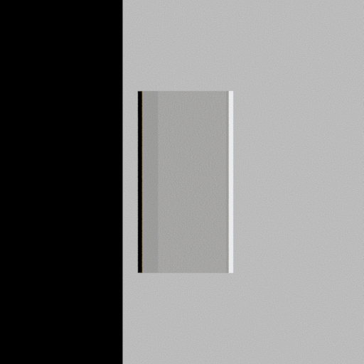

# Rust 光谱焦散渲染器

一个分阶段学习的 Rust CPU 离线光谱焦散渲染器。第一周目标是计算平行白光穿过三棱镜后落到地面的彩色能量分布，输出地面焦散俯视图。开发范围和验收标准见 [ROADMAP.md](ROADMAP.md)。

## 当前进度

**Day 1 已完成：输出链路与最小 Framebuffer。** 已实现：

- 二维 `Framebuffer`，用 `Vector3<f64>` 保存线性 XYZ，支持带边界检查的读写。
- XYZ → 线性 sRGB 矩阵转换，检查非有限值和计算溢出。
- 单通道线性 RGB → 显示 sRGB 编码，检查输入范围与非有限值。
- 线性 RGB 的显示范围裁剪、sRGB 8 位量化和 PNG 保存，自动创建输出目录。
- Day 1 曾通过 512×512 的 `output/test.png` 位置渐变图验证输出链路。
- Framebuffer、颜色转换与 PNG 读回测试。

**Day 2 已完成：光线、几何、最近交点与地面命中点灰度图。** `Ray::new` 检查输入并归一化方向，`at(distance)` 计算光线上的位置。`Ground`、`Triangle` 和 `Prism` 实现 `Hittable::intersect(&Ray) -> Option<Hit>`；`Scene::intersect` 遍历物体并返回最近交点。`render_ground_hits` 仅累计首先命中地面的光线，已保存 512×512 的 `output/ground_hits.png` 作为不透明遮挡示例。

**Day 3 已完成：固定折射率双界面折射与批量地面累积。** `scene::take_photon` 返回直接落地或通过玻璃两次折射后的地面落点；全反射、其他遮挡和未命中时返回 `None`。主程序用相同发射网格、总通量和曝光输出无三棱镜对照图及玻璃折射图。

**Day 4 已实现 Cauchy 及折射率模式。** `scene::refractive_index(wavelength_nm, mode)` 返回 `Option<f64>`：`IorMode::Constant` 忽略波长并使用 `1.52`，`IorMode::Dispersion` 要求有效波长并按 Cauchy 计算。`take_photon` 接收返回折射率的闭包。`render_refracted_ground_hits` 统一接收波长数组和 `IorMode`，固定折射率对照与三波长灰度调试共用这一个入口。

**Day 5 已完成：光谱积分与彩色 PNG 输出。** `spectrum` 导入可追溯的 CIE 1931 2° CMF 和 D65 相对 SPD，支持非整数波长的线性插值，按 `k × S(λ) × CMF(λ) × Δλ` 返回单个波长的线性 XYZ。`render_spectral_caustics` 独立发射与追踪光线，将 41 个波长的光子贡献直接双线性累积到一张 XYZ 图。`main` 以相同采样和曝光输出彩色 `output/caustics.png` 及固定折射率白光对照 `output/constant_ior.png`。数据、许可和校验和见 [assets/color/README.md](assets/color/README.md)。

**已接入双线性光子累积。** `render::utils::bilinear_weights` 根据落点的小数位置计算四个邻近像素及其权重，`caustics.rs` 将线性 XYZ 能量按权重分配；接收区域内的边缘落点也保留全部能量。这对应 Day 6 中的双线性 splat 子项。

**发射采用分层随机采样。** 每个小格各发射一条光线，x、y 分别使用独立的随机偏移。`StdRng` 使用固定种子 `42`；每次渲染都重新初始化，因此无三棱镜和折射图共享同一组发射位置，命中或丢弃光线不会改变后续采样序列。

阶段示例：

- Day 1 输出链路：[位置渐变测试图](output/test.png)。
- Day 2 几何验证：[地面命中点灰度图](output/ground_hits.png)。
- Day 3 对照：[无三棱镜](output/no_prism.png)、[固定折射率玻璃](output/refracted_hits.png)。
- Day 4 落点调试：[450 nm](output/wavelength_450nm.png)、[550 nm](output/wavelength_550nm.png)、[650 nm](output/wavelength_650nm.png)。
- Day 5 光谱积分：[色散彩色焦散](output/caustics.png)、[固定折射率白光对照](output/constant_ior.png)。



当前三棱镜和光源设置主要在光斑边缘形成窄色带；固定折射率对照保持中性灰白。两张图共用种子 42、4×4 空间分层采样、41 个波长和曝光 1.0。


`Ray` 保存 `origin`、单位方向 `direction`、方向倒数缓存 `direction_inv`、时间参数 `time` 与距离区间 `t_min/t_max`。统一使用 `Ray::new(origin, direction, time)` 构造；Rust 不支持默认函数参数，因此普通光线显式传入 `0.0`。预留的 `t_min/t_max` 初始值为 `(0, f64::MAX)`，当前地面与三角形求交均不读取这两个字段。时间字段目前仅保存数值，不模拟传播时间，与 `at(distance)` 的距离参数独立。零方向分量的倒数为 `±∞`，这是允许的缓存值；后续包围盒求交需单独处理平行轴，避免 `0 × ∞` 产生 NaN。

`Hit` 是纯数据记录，保存 `coords`、`normal`、`distance`，以及可选的 `object_id/material_id`。`Hit::default()` 仅提供字段初始值：向量全零、距离为 `f64::MAX`、编号为 `None`。命中状态统一由 `Option<Hit>` 表达：`Some(hit)` 表示命中，`None` 表示未命中。位置计算、法线归一化、合法性检查和正反面判断均由求交算法或调用方负责。`distance` 是距离，与 `Ray.time` 的时间含义独立。

物体和材质关联用 `Option<usize>` 保存编号，`None` 对应 C++ 示例中的空指针；后续场景管理负责按编号访问实际对象。`Hittable::intersect(&self, ray: &Ray)` 只接收光线并返回 `Option<Hit>`，具体实现填写命中记录后返回 `Some(hit)`。

`Ground::new(height)` 创建无限水平面 `z = height`，第一周场景使用 `Ground::new(0.0)`。求交距离为 `(height - ray.origin.z) / ray.direction.z`，检查平行、非有限值、溢出及 `1e-6` 米的自相交阈值。地面支持双面求交，法线始终为 `(0, 0, 1)`，不会随入射方向翻转。`Ground` 只负责几何求交；`render::caustics::ground_to_pixel` 将交点映射为连续像素坐标，`render::utils::bilinear_weights` 计算四邻域权重，`Framebuffer::accumulate` 累加每份线性 XYZ 并拒绝非有限结果。

`Triangle::new(v0, v1, v2)` 保存三个顶点并缓存两条边和单位几何法线，拒绝非有限顶点、退化三角形及计算溢出。法线按 `(v1 - v0) × (v2 - v0)` 定向，顶点和缓存保持私有，保证二者一致。求交采用双面的 Möller–Trumbore 算法，求解 `origin + t * direction = v0 + u * edge1 + v * edge2`；交点需满足 `u >= 0`、`v >= 0`、`u + v <= 1`，以及正向距离 `distance > 1e-6` 米。算法填写 `Hit.coords/normal/distance`，其余预留字段沿用默认值，`Hit` 本身保持纯数据结构。

`Prism::new()` 使用默认六顶点，`Prism::from_vertices` 使用配置的六顶点并检查凸性、退化和法线方向；均组成 8 个三角形：两个三角形端面，加上三个各拆成两个三角形的矩形侧面。三角截面沿 y 轴从 `-1` 米拉伸至 `1` 米，底面为 `z = 1` 米，顶棱为 `z = 1.8` 米；所有三角形法线朝外。求交遍历所有面并取最近有效交点，支持从内部寻找出射面。

`scene::Scene::new()` 创建空场景，保存真实物体 `objects: Vec<Box<dyn Hittable>>`、运行时相机、光源、地面接收区域与背景色。图片宽高归 `RenderSetting` 和运行时 `Render` 管理。`Scene::from_config(&config.scene)` 根据 JSON 中的类型和顶点构建物体并记录地面/三棱镜编号。`Box<dyn Hittable>` 让不同具体类型的物体保存在同一个集合中，通过 `add` 显式添加；返回的下标用于识别命中物体：

```rust
let mut scene = Scene::new();
let prism_id = scene.add(Box::new(Prism::new().unwrap()));
let ground_id = scene.add(Box::new(Ground::new(0.0).unwrap()));
```

`Scene::intersect(&ray)` 返回最近的 `Option<Hit>`，并填写 `Hit.object_id`；`material_id` 仍为 `None`。物体编号是当前集合下标，查询期间不能重排集合。渲染入口从 `RenderSetting` 获取宽高，`camera` 与 `background_color` 不参与当前光源追踪。

`take_photon(&scene, ray, prism_id, ground_id, glass_ior)` 按顺序执行首次求交、空气 → 玻璃折射、内部求交、玻璃 → 空气折射、最后一次地面求交。`glass_ior` 类型为 `impl FnOnce() -> Option<f64>`，通过 `||` 创建无参数闭包，并捕获当前波长和模式。函数只调用一次闭包，将得到的玻璃折射率用于两个界面；闭包返回 `None`、非正或非有限折射率时返回 `None`。空气折射率固定为 `1.0`。界面起点沿法线偏移 `1e-5` 米，后续 Ray 保留原来的 `time`。入射使用朝外法线，出射使用取反后的法线。光线需从空气中出发，不处理已有玻璃内部起点。

`refractive_index(None, IorMode::Constant)` 返回 `Some(1.52)`，传入其他波长也不改变该模式的结果；`refractive_index(Some(wavelength_nm), IorMode::Dispersion)` 使用 `n = 1.5046 + 0.0042 / (wavelength_nm / 1000)²`，除以 1000 将 nm 转为 μm。参数来自路线图，仅用于演示，不代表特定真实玻璃。色散模式下缺少波长、波长非正或非有限、计算溢出时返回 `None`。450 nm 时折射率约为 `1.52534`，650 nm 时约为 `1.51454`；同一条从 `(0.25, 0.2, 3)` 向下发射的光线分别落在约 `(-0.73212, 0.2, 0)` 与 `(-0.70696, 0.2, 0)`。调用示例：

```rust
use spectral_caustics::{
    optics::iormode::IorMode,
    scene::{refractive_index, take_photon},
};

let wavelength_nm = 450.0;
let mode = IorMode::Dispersion;
let position = take_photon(&scene, ray, prism_id, ground_id, || {
    refractive_index(Some(wavelength_nm), mode)
});
// 也可以直接提供自定义固定折射率：
let position = take_photon(&scene, ray, prism_id, ground_id, || Some(1.52));
```

批量落点调试由 `Render::refracted_hits(&scene, wavelengths_nm, mode)` 调用同一套配置化追踪入口，返回 `[Framebuffer; N]`。顺序与输入一致，总通量在 N 张图之间等分。固定模式通常传 `[None]`；色散模式要求有效的 `Some(波长 nm)`：

```rust
use spectral_caustics::{config::Config, render::Render, scene::Scene,
    render::caustics::DEBUG_WAVELENGTHS_NM, optics::iormode::IorMode};

let config = Config::load("configs/default.json")?;
let scene = Scene::from_config(&config.scene)?;
let renderer = Render::new(config.render.clone())?;
let [constant] = renderer.refracted_hits(&scene, [None], IorMode::Constant)?;
let wavelengths = renderer.refracted_hits(
    &scene, DEBUG_WAVELENGTHS_NM.map(Some), IorMode::Dispersion,
)?;
```

## 波长到 XYZ

`optics::spectrum::cie_xyz(wavelength_nm)` 查询颜色匹配函数，`d65_spd(wavelength_nm)` 查询光源功率密度。`wavelength_to_xyz(wavelength_nm, spectral_power, delta_lambda_nm, k)` 将二者与积分宽度相乘，返回 `Option<Vector3<f64>>`。所有波长共用一个 k，不能逐个波长归一化。对于 D65，取 `k = 1 / Σ[S(λ)ȳ(λ)Δλ]`，使未经过滤的完整白光 Y = 1；使用相对 Y = 1 而不是 Y = 100，与当前 PNG 输出链路一致。

```rust
use spectral_caustics::optics::spectrum::{d65_normalization, d65_spd, wavelength_to_xyz};

// 380–780 nm，每 10 nm 一点；梯形积分在两个端点使用半权重。
let samples: Vec<(f64, f64)> = (380..=780)
    .step_by(10)
    .map(|nm| (nm as f64, if nm == 380 || nm == 780 { 5.0 } else { 10.0 }))
    .collect();
let k = d65_normalization(&samples).unwrap();

// 550 nm 这一项的 XYZ 贡献；后续按各自光路落点与空间通量权重累积。
let xyz_i = wavelength_to_xyz(550.0, d65_spd(550.0).unwrap(), 10.0, k).unwrap();
```

`Δλ` 已包含积分宽度，不再除以波长样本数；空间发射数的通量归一化仍由渲染层负责。k 在追踪前按完整光源计算，全反射或未落地的波长不会使剩余通量重新归一化。这里实现离散积分；随机波长采样的 `1 / p(λ)` 权重仍需在接入该采样方式时处理。

两张表均使用原始 1 nm 数据，表内线性插值，表外按官方元数据返回零；非正或非有限波长返回 `None`。功率或 k 为负、积分宽度非正、非有限输入及计算溢出也返回 `None`。

`render::caustics::render_spectral_caustics` 独立执行分层发射和光谱追踪，不调用灰度渲染入口。根据 `render.wavelength_min_nm/max_nm/step_nm` 建立梯形积分节点（默认 380–780 nm 的 41 点，末段不足步长时使用实际宽度），在追踪前将 `k × S(λ) × CMF(λ) × Δλ × 空间通量权重` 求和为完整白光贡献 `direct_xyz`。`Constant` 只计算一次玻璃折射率 `1.52`，不保存逐波长光路贡献；`Dispersion` 才缓存各波长的折射率和 XYZ。所有波长共用种子 42 和相同空间发射位置；每条空间光线只查询一次首次最近交点。直接命中地面时，用完整白光贡献做一次双线性 splat；命中三棱镜时，固定模式只追踪一次双界面折射并用 `direct_xyz` 累积一次，色散模式才逐波长继续折射并累积各自的 XYZ；其他遮挡或未命中直接丢弃。各并行块将所有波长合成到自己的 XYZ 图，最后合并为一张图，不生成 41 张逐波长中间灰度图，也不需要除以或乘回 41。

光谱渲染使用 Rayon 线程池：发射采样行按 `render.max_spectral_blocks` 分块（默认最多 16 块），每块独立累积到自己的 Framebuffer，全部计算完成后按块编号依次合并线性 XYZ。各块使用全图光线数归一化，合并时直接相加，不再除以块数或线程数；追踪期间没有共享可写的像素或 RNG。512×512 时一张 XYZ 图为 6 MiB，16 张局部图加最终图的像素缓冲峰值约为 102 MiB。灰度调试入口仍按原来的串行流程执行。

为保留原版采样位置，光谱分块显式使用 `rand_chacha::ChaCha12Rng`，通过 [`set_word_pos`](https://docs.rs/rand_chacha/0.9.0/rand_chacha/struct.ChaCha12Rng.html#method.set_word_pos) 直接定位各块的随机序列起点，不再串行生成并丢弃前面的随机数。当前锁定的 `rand 0.9.5` 的 `StdRng` 使用同一算法；每条光线的 X/Y 两个 `f64` 偏移消耗四个 `u32` word，因此块起点为 `start_row × samples_x × 4`。任务只生成自己实际使用的随机数，不保存全图的 Ray 或随机偏移。分块边界和合并顺序与线程数无关，避免并行浮点归约的调度顺序影响输出。不同线程数的 XYZ 结果应完全一致；与旧串行版相比，加法分组改变可能产生末位舍入差异。

这里的“只算一次”针对同一条空间光线的波长分量；不同发射位置仍独立采样。完整白光使用当前 D65/CIE 积分的 XYZ 总和，保留 `Δλ` 和空间权重，不能取单个波长的贡献代替。固定模式也保留这一步渲染前的光谱积分，只省去每条空间光线内重复的波长追踪和累积；不同空间光线落在同一像素时仍需累加。`take_photon` 保留原有单光线接口，批量追踪通过内部的 `take_photon_from_hit` 复用首次交点。灰度调试也复用首次交点；固定模式只追踪一次玻璃路径，并把同一落点交给 N 张图，但每张图仍分别累积 `1/N` 通量。合并 XYZ 加法的顺序改变后，浮点结果可能存在末位舍入差异。

```rust
use spectral_caustics::{config::Config, render::Render, scene::Scene};

let config = Config::load("configs/default.json")?;
let scene = Scene::from_config(&config.scene)?;
let renderer = Render::new(config.render.clone())?;
let framebuffer = renderer.render(&scene)?;
renderer.save(&framebuffer, &config.render.output_path)?;
// renderer.render_mode(&scene, IorMode::Constant) 可生成同配置的固定折射率对照。
```

完整 D65 光谱在追踪前计算统一 k；遮挡、全反射及接收区外的通量直接丢弃。增加空间采样数不会直接增加亮度。固定折射率模式下所有波长路径相同，默认完整 D65 积分后保持中性白；色散模式下各波长落点不同，合成后才呈现空间颜色差异。

## JSON 配置层

`configs/default.json` 统一保存两份纯数据描述，默认值与当前示例场景和主要渲染参数一致：

| 配置 | 主要字段 |
| --- | --- |
| `RenderSetting`，JSON 中的 `render` | 图片宽高、空间采样数、折射率模式、波长范围/步长、曝光、种子、线程数、采样块数上限、主图输出路径 |
| `SceneConfig`，JSON 中的 `scene` | 相机 `camera`、物体描述、平行光源、地面接收范围与背景色 |

`ObjectConfig` 用 `type` 区分 `prism` 和 `ground`：三棱镜保存六个原始顶点，地面保存高度；它们不是 `Box<dyn Hittable>`，也不保存法线、求交函数或渲染缓冲。长度以米表示，波长字段显式使用 nm。光源 `total_flux = 8.0` 是原有 `0.5 × 16` 的相对总通量，没有新增瓦特单位约定。

统一读写入口是 `config::Config`：

```rust
use spectral_caustics::config::Config;

let config = Config::load("configs/default.json")?;
let json = config.to_json()?;
let same_config = Config::from_json(&json)?;
same_config.save("configs/config-copy.json")?;
```

读写入口校验基本数值并拒绝未知字段；非有限值不能写成 JSON，非法配置不会覆盖已有文件。`mode` 使用 `"constant"` 或 `"dispersion"`，`thread_count: null` 表示使用 Rayon 默认线程数。JSON 浮点解析启用往返精度支持，以保留 `f64` 几何坐标；`Scene::from_config` 构建并检查实际几何；当前支持一个地面和至多一个凸三棱镜，顶点顺序须与示例保持一致。

`main` 已接入完整链路：`Config::load` → `Scene::from_config` → `Render::new` → 追踪、曝光、PNG。光源孔径控制发射位置，光源方向会归一化；地面高度和三棱镜顶点用于实际求交，接收区域控制落点裁切和像素映射。尺寸、采样数、种子、波长范围/步长、折射模式、线程/分块数、曝光和主图路径均来自 JSON。相机由 `scene.camera` 构建为 `Scene.camera`；相机视角与背景色仍不参与当前地面俯视焦散计算。

## 相机与像素主光线

`scene.camera` 保存针孔透视相机参数，默认值为：

```json
{
  "position": [3.0, -5.0, 3.0],
  "target": [0.0, 0.0, 1.3],
  "up": [0.0, 0.0, 1.0],
  "fov_y_degrees": 45.0
}
```

`position` 是相机位置，`target` 是观察目标，坐标单位为米；`up` 是画面向上的参考方向，默认采用世界 +z。`fov_y_degrees` 是垂直视场角，水平视野由图片宽高比确定。原来预留的 `scene.fov_degrees` 已移除，旧配置需要改为这里的 `scene.camera.fov_y_degrees` 并补齐相机参数。

```rust
use spectral_caustics::{config::Config, scene::Scene};

let config = Config::load("configs/default.json")?;
let scene = Scene::from_config(&config.scene)?;
let ray = scene.camera.ray_for_pixel(
    256, 256, config.render.width, config.render.height,
).ok_or("像素或相机参数无效")?;
let hit = scene.intersect(&ray);
```

`ray_for_pixel(x, y, width, height)` 接收从零开始的像素下标，图像原点位于左上角，x 向右、y 向下。光线从 `position` 出发，穿过像素中心，返回方向归一化、`time = 0` 的 `Option<Ray>`。零尺寸、越界、非有限数值、重合的位置/目标、零 up、与观察方向平行或近平行的 up、无效 FOV 都会被拒绝。

计算时先建立相机的正交坐标系：`forward = normalize(target - position)`，`right = normalize(forward × up)`，`camera_up = right × forward`。虚拟成像平面位于相机前方 1 米处，半高为 `tan(fov_y / 2)`，半宽再乘 `width / height`。像素中心映射到平面坐标后，主光线方向为 `normalize(forward + image_x × right + image_y × camera_up)`。例如相机朝世界 -z、up 为 +y，FOV 为 90° 时，2×2 图像左上像素的平面偏移为 `(-0.5, +0.5, -1)`。

本阶段完成相机、JSON 校验与运行时构建；集成测试确认中心光线能命中三棱镜，改变观察目标后能命中地面。默认程序仍输出原有地面焦散图，尚未接入相机视图的着色或路径追踪。下一步可先遍历相机像素并显示最近交点，再加入材质、光照和路径采样。

## 运行

安装 Rust stable 后，在仓库根目录执行：

```bash
cargo run --release --locked
```

默认读取 `configs/default.json`，也可显式指定配置文件（相对输出路径相对于程序启动目录）：

```bash
cargo run --release --locked -- /path/to/config.json
```

当 JSON 的 `render.thread_count` 为 `null` 时，可通过 Rayon 环境变量控制线程数，例如：

```bash
RAYON_NUM_THREADS=4 cargo run --release --locked
```

若 `thread_count` 为正整数，`Render` 创建指定线程数的专用池，此设置优先于环境变量。线程数只控制执行任务的工作线程数量；固定分块和种子下，线程数改变不会改变结果。

默认配置输出七张 512×512 PNG：

| 文件 | 内容 |
| --- | --- |
| `output/caustics.png` | 41 点 D65/CIE 光谱积分，Cauchy 色散彩色焦散 |
| `output/constant_ior.png` | 同样的光谱、采样和曝光，玻璃固定 n = 1.52 的白光对照 |
| `output/no_prism.png` | 无三棱镜的灰度对照 |
| `output/refracted_hits.png` | 固定折射率玻璃的灰度地面分布 |
| `output/wavelength_450nm.png`、`output/wavelength_550nm.png`、`output/wavelength_650nm.png` | 三个波长各自的灰度落点调试图 |

主图使用 JSON 中的 `render.mode` 和 `output_path`；其余六张图保存到主图目录。主图为 `dispersion` 时，对照为 `constant_ior.png`；主图为 `constant` 时，对照为 `dispersion.png`。全部输出共用配置曝光；450/550/650 nm 三张灰度图是固定波长调试，不随主积分范围改名。主图名称与辅助图冲突时，辅助图加 `debug_` 前缀，避免覆盖主图。

默认从 `z = 3` 米的 4×4 米区域发射向下的平行光，方向为 `(0, 0, -1)`。每个发射小格分为 4×4 层，每层随机取一点，共 4,194,304 个空间发射位置。每张光谱积分图使用 380–780 nm、10 nm 间隔的 41 个波长，对应 171,966,464 份波长贡献；直接落地的 41 份合并计算，只有色散模式下首先命中三棱镜的光线才执行 41 条折射路径，固定模式每个位置始终最多追踪一条路径。两个端点的积分宽度为 5 nm，其余为 10 nm。两种折射率模式都重新从种子 42 开始，逐张渲染并保存。

三波长调试在每个位置复用同一条初始 Ray 及首次交点，对应 `Some(450.0)`、`Some(550.0)`、`Some(650.0)`，合计分配 12,582,912 份波长贡献；直接落地只计算一个落点，再分别写入三张图。每轴的发射位置使用 `(sample_index + rng.random::<f64>()) / sample_count`，偏移在 `[0, 1)` 内；世界 x、y 均从区域最小值开始递增，图片的 y 翻转仍由地面映射负责。

接收区域为地面 `x、y ∈ [-2, 2)` 米，世界 +x 朝图片右侧，+y 朝图片上方。无三棱镜时平均线性亮度保持 0.5，单个像素会有采样波动；线性亮度恰为 0.5 时，XYZ → 线性 sRGB → sRGB 编码结果为 `[188, 188, 188]`。加入玻璃后，透射落点向两侧移动，与直射光叠加形成更亮的区域；原来的部分区域没有光线落入。单条已知光线的地面落点从无玻璃时的 `(0.25, 0.2, 0)` 移至约 `(-0.7196, 0.2, 0)`。

在 `configs/default.json` 中修改 `render.samples_per_pixel_axis` 可以改变每格的采样数。各光路复用相同的发射网格、像素映射和归一化：相对总通量由 `scene.light.total_flux` 指定（默认 `0.5 × 16`），每条光线的通量除以总光线数，再除以像素对应的地面面积后累积。增加采样数不会直接提高亮度；边界采样和全反射可能使落地通量有少量变化。三波长调试把每条空间光线的通量等分为三份，每张图使用 `1/3` 权重；某个波长未命中、全反射或落在接收区域外时，仅丢弃它对应的通量，不给其余波长重新分配。三张图的线性 XYZ 总和保持原来的能量尺度，不能直接对 sRGB PNG 像素求和。这里使用三个等权离散光谱分量，不是对 380–780 nm 连续光谱的积分，也未加入 CIE CMF 或 D65 SPD。这个灰度标尺没有实际光源功率单位。

种子通过 `configs/default.json` 中的 `render.seed` 设置，光谱和灰度入口均使用它。相同参数、种子和锁定依赖下输出可复现；`Cargo.lock` 当前锁定 `rand 0.9.5`。升级随机数库可能改变 `StdRng` 的序列，保存图像对比时应保留锁文件。

双线性分配使用像素中心约定：地面归一化坐标为 `(u, v)` 时，连续图片坐标为 `x = u * width - 0.5`、`y = (1 - v) * height - 0.5`。整数坐标就是像素中心，保留小数后才计算相邻四点。以左上邻点为基准，小数部分为 `(dx, dy)`，四个权重依次为 `(1-dx)(1-dy)`、`dx(1-dy)`、`(1-dx)dy`、`dx*dy`，总和为 1。落在边缘半像素内时夹紧到边缘像素中心，避免向图外分配而损失能量；地面接收区域外的落点仍丢弃。

Day 3 的单条光线折射示例：

```bash
cargo run --locked --example refract_ray
```

示例按顺序执行空气 → 玻璃（`n = 1.52`）→ 空气 → 地面，打印入射点、玻璃内方向、出射点、出射方向和地面落点。`refract` 要求单位方向、单位法线，且法线朝向入射介质，所以出射调用使用 `-exit.normal`。界面处沿法线偏移 `1e-5` 米；全反射时终止并报告原因。`examples/refract_ray.rs` 保留了逐步展开的写法，方便对照 `take_photon` 阅读。

仅运行地面求交的 11 项测试：

```bash
cargo test --locked ground::tests
```

测试中的已知示例：从 `(0, 0, 2)` 向下发射，命中 `Ground::new(0.0)` 时距离为 `2` 米、交点为 `(0, 0, 0)`；斜射到 `z = 1` 的地面、从地面下方命中、平行与自相交等情况也有对应验证。

检查格式、运行测试与 Clippy：

```bash
cargo fmt --check
cargo test --locked
cargo clippy --locked --all-targets -- -D warnings
```

当前 128 项单元测试和 8 项集成测试通过，严格 Clippy 通过。彩色合成测试覆盖 XYZ 通量与采样数归一化、独立单波长合成及遮挡丢失通量、固定模式中性白、色散分色与可复现、非法配置以及彩色 PNG 读回。新增光谱测试检查官方表格完整性及列和、已知 CMF/SPD 值、非整数波长插值、端点与表外行为、积分权重、D65 白点、不同积分步长的稳定性，以及非法输入和溢出。统一入口测试覆盖单张固定模式图与多张固定模式图的通量一致性、两模式共享采样、固定模式各波长分布相同而色散模式不同，以及色散波长缺失、非法或溢出时返回错误。测试覆盖固定模式忽略波长、色散模式要求有效波长、闭包只求值一次并复用于两个界面、闭包返回非法折射率时拒绝追踪、Cauchy 单位换算、可见光区间折射率单调性、非法波长与溢出、两种波长通过双界面后的已知落点，以及传入光子追踪的非法波长。三波长测试检查共享空间采样、完整 XYZ 能量守恒、采样数归一化、丢失通量不重分配、各波长结果与独立单波长追踪一致，以及图像分布不同且可复现。采样测试逐格检查每层恰有一个点、点不越出所属层、两轴随机偏移，以及固定种子下的发射位置和图像完全重复。增加采样数时检查总能量守恒与无玻璃图的噪声降低；两种光路通过同种子对照验证发射位置一致。其余测试覆盖场景最近交点与物体编号、非正方形图片的坐标映射、区域边界与非有限输入、三棱镜遮挡、XYZ 累积溢出保护，以及灰度图的 PNG 读回。双线性测试覆盖已知小数位置的四点权重、像素中心、权重和、边缘与单像素尺寸、完整 XYZ 总能量守恒及遮挡边缘的平滑分配。折射测试覆盖法向与近法向入射、临界角两侧、全反射、法线方向、非法数值、Snell 定律和单条光线通过两个界面后落地；`take_photon` 测试还覆盖直接落地、未命中、三个传播阶段的其他遮挡、编号与添加顺序。

7 项三棱镜测试覆盖 8 个面的已知交点和朝外单位法线、最近面选择、棱边命中、内外求交、自相交与非有限光线；场景测试验证同一集合中不同物体的求交，以及改变添加顺序后仍选择最近交点。

单三角形的 15 项测试涵盖已知交点和法线、斜射、双面命中、顶点顺序、三条边内外与顶点、平行/共面、自相交、预留距离字段不影响命中、退化输入、非有限值、溢出及小尺寸三角形。

PNG 读回测试在独立临时目录中保存一张 3×2 小图，再解码检查尺寸、RGB8 像素格式和六个位置的红、绿、蓝、白、灰、黑颜色。线性灰色 `0.5` 必须保存为 `[188, 188, 188]`，用于检查 sRGB 编码和量化是否正确。测试成功后清理临时文件。

## 文件与颜色约定

源码按用途分为四组，`src` 顶层保留程序入口、模块入口、相机和场景：

```text
configs/
└── default.json              # 默认场景和渲染参数
src/
├── main.rs                   # 读取配置、渲染并保存对照图
├── lib.rs                    # 对外声明模块
├── camera.rs                 # 针孔相机与像素主光线
├── scene.rs                  # 场景集合、最近求交与双界面追踪
├── config/
│   ├── mod.rs                # Config、JSON 读写和校验
│   ├── cameraconfig.rs        # CameraConfig
│   ├── rendersetting.rs      # RenderSetting
│   └── sceneconfig.rs        # SceneConfig、物体/光源/接收区域描述
├── geometry/
│   ├── mod.rs
│   ├── ray.rs                # 光线、方向归一化和求交阈值
│   ├── hit.rs                # 交点记录
│   ├── object.rs             # Hittable 统一求交接口
│   ├── ground.rs             # 水平地面
│   ├── triangle.rs           # 三角形求交
│   └── prism.rs              # 三棱镜及最近交点
├── optics/
│   ├── mod.rs
│   ├── iormode.rs            # 固定折射率 / 色散模式
│   └── spectrum.rs           # CIE/D65 插值与光谱积分
└── render/
    ├── mod.rs                # Render、XYZ → sRGB → PNG
    ├── caustics.rs           # 分层发射、光路追踪与地面累积
    ├── framebuffer.rs        # 线性 XYZ 图像缓冲
    └── utils.rs              # 双线性四邻域与权重
```

- `assets/color/` 保存 CIE 原始 CSV、官方 metadata、来源、许可与校验和说明。
- `examples/refract_ray.rs` 演示单条光线进入三棱镜、内部传播、出射及落地。
- `tests/config_render.rs` 验证 JSON 配置驱动的场景、渲染和程序输出。
- `output/` 保存 PNG 结果。

模块引用与目录对应，例如 `geometry::ray::Ray`、`config::rendersetting::RenderSetting`、`optics::spectrum::cie_xyz`、`render::framebuffer::Framebuffer`。Snell 折射、Cauchy 折射率和 `take_photon` 仍由 `scene.rs` 提供。

XYZ 转换使用 D65 白点约定，参考白的 Y = 1。矩阵来自 [W3C CSS Color 4 的颜色转换示例](https://www.w3.org/TR/css-color-4/#color-conversion-code)，保留负值和大于 1 的线性 RGB 分量。

单通道编码公式来自 [ICC sRGB 编码登记表](https://registry.color.org/rgb-registry/srgb)。编码函数接收 `[0, 1]` 内的有限线性值，非法输入返回 `None`。PNG 导出时先将线性 RGB 逐通道裁剪到 `[0, 1]`，再编码、乘 255 并四舍五入为 `u8`。

## 当前简化与限制

- 地面为双面、无限大的水平面，默认场景约定高度为 `0`；图片仅记录 `x、y ∈ [-2, 2)` 米的有限区域。光线方向保持单位长度，返回的距离才表示米。
- 当前 `Ground` 和 `Triangle` 的几何求交仅要求有限的正向距离大于自相交阈值，不使用预留的 `ray.t_min/t_max`。改变光线方向时应重新构造 `Ray`，以归一化方向并同步 `direction_inv` 缓存。
- 求交忽略 `t <= 1e-6` 米的交点，以防止自相交；单位方向的 `|direction.z| <= 1e-12` 时视为平行。两个阈值分别作用于距离和方向分量。
- 三角形复用 `1e-6` 米的距离阈值；平行判断使用单位方向与单位法线的点积绝对值，阈值为 `1e-12`，与三角形面积独立。三棱镜采用固定顶点，棱边处返回最近面之一的法线；棱边没有唯一的几何法线。
- 曝光由 `render.exposure` 控制，在线性颜色空间施加；不会根据每张图片的最大值自动归一化。
- 显示范围采用逐通道裁剪，可能丢失高亮和色域外的颜色细节；Framebuffer 中的线性 XYZ 数据保留原值。
- 固定折射率对照使用 `1.52`，三波长批量调试使用 Cauchy 色散和等权离散分量。各波长图仍采用 D65 参考白缩放以显示落点密度，尚未按真实光谱颜色匹配函数着色，也未进行连续光谱积分。
- 彩色合成支持 JSON 中的波长范围/步长（当前限定 380–780 nm），采用含右端点的梯形积分；每个 Rayon 采样块直接累积所有波长到自己的 XYZ 图，全部完成后顺序合并，512×512 时像素缓冲峰值约 102 MiB。有限波长范围与积分步长使 D65 白点略有误差，固定模式 PNG 允许 RGB 通道相差 1 个字节。
- `take_photon` 最多经过两个玻璃界面；全反射直接终止，不继续内部反射。未计算 Fresnel 反射损失和吸收；超出接收区域的落点不写入图像。
- 光源高度、方向、发射孔径、总通量和地面接收范围均可由 `scene` 配置；光源仍是从水平矩形发射窗口出发的平行光。分层随机采样与双线性 splat 减轻周期性条纹，但有限采样仍产生颗粒噪声，可增加 `samples_per_pixel_axis` 来降低噪声；较亮落点还可能被显示范围裁剪，没有按每张图的最大值自动归一化。
- Day 6 的 JSON 参数入口已接入；后续仍可补充成功落地、全反射和丢弃光子统计。

使用 `nalgebra` 进行数学计算，`image` 编解码 PNG，`rand` 提供固定种子的格内随机偏移，`rand_chacha` 提供随机序列的直接定位接口，`rayon` 并行执行光谱采样块。`Cargo.lock` 随项目提交；`.gitignore` 放行上述七张默认输出，以及 Day 1 的 `output/test.png`、Day 2 的 `output/ground_hits.png` 阶段示例，编译目录 `target/` 和其他生成文件继续忽略。
