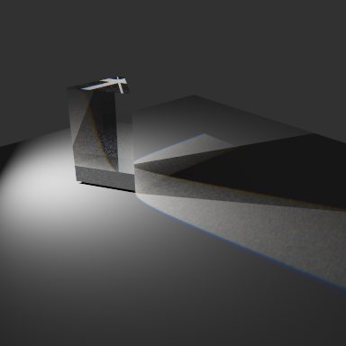
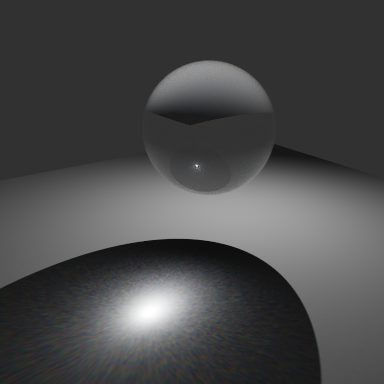

# Spectral Caustics Renderer

Rust CPU 离线渲染器，支持平行光/圆盘面光源、理想 Dielectric Sphere/Prism 的光源端光谱焦散、独立 Hero Wavelength 光谱相机，以及 HDRI、MIS、有界 RGB BSDF 路径和 Rayon 并行。默认展示 Glass、Mirror、GGX 三个球体；光源焦散场景为 [configs/sphere.json](configs/sphere.json)，光谱相机场景为 [configs/sphere_spectral.json](configs/sphere_spectral.json)。当前能力与开发边界见 [ROADMAP.md](ROADMAP.md)。

## 运行与输出

从仓库根目录执行，需要支持 Rust 2024 edition 的工具链：

```sh
cargo run --release --locked
cargo run --release --locked -- configs/sphere.json
cargo run --release --locked -- configs/sphere_spectral.json
cargo run --release --locked -- /path/to/config.json
```

默认读取 [configs/default.json](configs/default.json)，使用随附的 `assets/HDRI/herkulessaulen_4k.hdr`。画面从左到右为玻璃（IOR=1.52）、Mirror（反射率 0.95）、GGX（roughness=0.4，RGB eta=0.2、k=3），地面为棋盘格。配置、HDR 和输出的相对路径均以启动目录为基准。

| 输出 | 内容 |
| --- | --- |
| `render.output_path`，默认 `output/spheres/camera_combined.png` | Combined = Direct + Caustics |
| 同目录的 `camera_direct.png` | 太阳、环境与相机续追贡献 |
| 同目录的 `camera_caustics.png` | 首次地面着色的光谱焦散贡献 |

三图共用一批相机路径。默认三球对照场景没有开启焦散；`sphere.json` 显式选择色散玻璃球，输出到 `output/sphere/`，其中 `camera_caustics.png` 包含球体的光谱焦散，`camera_combined.png` 为合成图。多波长重叠处接近白色，色散主要体现在焦散色边。RGB 自定义主图文件名时只保存指定名称；辅助图与主图重名时加 `aux_` 前缀。Hero 开启焦散时额外保留标准三分量文件，见下文。PNG 使用同一曝光，经 XYZ → linear sRGB → 曝光 → 简化 ACES → display sRGB 输出，生成图位于忽略的 `output/` 中。

ACES 对曝光后的每个线性 RGB 通道应用 `x=max(x,0)`、`clamp(x*(2.51*x+0.03)/(x*(2.43*x+0.59)+0.14),0,1)`；进入曲线前不把高光直接截断为 1。XYZ 缓冲和分量合成仍在线性空间中进行，仅 PNG 导出应用色调映射。Direct + Caustics = Combined 在导出前成立；经过非线性的 ACES/sRGB 后，PNG 像素不能直接相加。统计 AOV 保留原有直接量化方式。

## 配置

| 参数 | Rust 内置默认 | 展示 JSON |
| --- | --- | --- |
| `render.width/height` | 512×512 | 768×432 |
| `render.camera_spp` | 64 | 256 |
| `render.spectral_packet_size` | 1 | 默认展示省略；光谱球场景为 4 |
| `render.camera_mode` | `rgb` | 默认展示为 `rgb`，光谱相机场景为 `spectral` |
| `scene.environment_samples` | 1 | 8 |
| `scene.light.type` | `parallel` | 旧 JSON 省略；圆盘测试为 `disk_area` |
| `scene.light_samples` | 1 | 圆盘面光源测试场景为 8；平行光不抽取面积样本 |
| `scene.environment_mis_heuristic` | `balance` | `power` |
| `scene.max_diffuse_bounces` | 0 | 4 |
| `render.debug_path` | `false` | `false` |
| `render.spectral_debug_disable_ground_sun` | `false` | 省略；仅观察暗地面焦散时开启 |

`Config::default()` 保留单三棱镜实验场景和渐变天空；主程序加载上述 JSON。JSON 省略 `scene.environment` 或设为 `null` 会关闭环境照明，使用常量背景；环境中的 `map_path` 省略/null 时使用渐变，否则加载 HDR。`rotation_degrees` 绕 +Z 旋转，`intensity` 在线性空间缩放。

- `camera_spp` 始终是每像素总路径数；光谱 `spectral_packet_size` 只支持 1/4，取 4 时 SPP 必须被 4 整除。RGB 和光源端的采样不受 Packet 设置影响。`samples_per_pixel_axis` 独立控制光源每轴分层采样。
- `seed` 固定随机种子；`thread_count=null` 使用 Rayon 默认线程数，正整数创建专用池；`max_spectral_blocks` 控制光源采样块数。
- `max_diffuse_bounces` 表示额外连续 BSDF 连接数，包含 Diffuse/Glossy，范围 0..1024；4 最多访问 5 个连续着色顶点。
- 场景采用米制、Z-up；JSON 支持一个地面、至多一个 `Prism` 或 `VerticalPrism`，以及多个球体/圆角三棱镜。Sphere/Prism/VerticalPrism 的 `caustics` 开关显式选择至多一个理想 Dielectric 焦散目标，不依赖物体下标或 `debug_object_id`。Sphere/VerticalPrism 缺省关闭；Prism 缺省开启以兼容旧配置，非介质 Prism 仍只遮挡光线。Sphere/VerticalPrism 开启时绑定非介质材质会报错。
- `receiver` 限制光子图范围，地面在其外扩 `ground_margin_m`，不限制解析太阳照明。
- `render.mode=constant` 使用材质的 `ior`；`dispersion` 使用其 Cauchy 模型，未配置模型则仍为常数。它同时控制光源端与独立光谱相机的 IOR 模式；RGB 相机始终使用常数 `ior`。光子积分的波长范围/步长以 nm 配置，光谱相机固定在 380–780 nm 采样。

材质使用 `type` 区分，所有参数必须有限，颜色为线性 RGB：

| 类型 | 参数与范围 |
| --- | --- |
| `lambertian` | `albedo`：三个 [0,1] 分量 |
| `dielectric` | `ior`：有限正数；可选 `dispersion`：Cauchy 参数 `a>0`、`b_um2≥0` |
| `mirror` | `reflectance`：三个 [0,1] 分量 |
| `ggx_metal` | RGB `eta>0`、`k≥0`，`roughness∈[0,1]` |

球体光谱配置的关键字段：

```json
{
  "type": "sphere",
  "center_m": [0.0, 0.0, 0.83],
  "radius_m": 0.8,
  "caustics": true,
  "material": {
    "type": "dielectric",
    "ior": 1.52,
    "dispersion": { "a": 1.5046, "b_um2": 0.0042 }
  }
}
```

`n(λ)=a+b_um2/λ_μm²`；输入波长为 nm，模型内部转换为 μm。上述参数用于演示，不代表特定实测玻璃。显式 Dielectric 的 `dispersion` 省略/null 表示常数；整个 `material` 省略时，保留旧演示玻璃默认值（1.52 和上述 Cauchy）。Rust 构造 `MaterialConfig::Dielectric` 需提供 `dispersion`，构造 `ObjectConfig::Sphere/Prism` 需提供 `caustics`；现有调用方已迁移。手工场景使用 `add_with_material` 后调用 `select_caustics_object(id)`，单条材质光谱路径可用 `trace_caustics_photon`；旧 `prism_id`、显式 IOR 的 `take_photon_landing` 和演示 `refractive_index` 保留。

完整球体配置见 [configs/sphere.json](configs/sphere.json)，圆角三棱镜见 [configs/beveled_prism.json](configs/beveled_prism.json)。圆角仅作用于三条长棱，每角固定 8 段；`bevel_size_m` 是沿原边的切点距离，每条边须长于它的两倍。实际求交使用分段几何法线，没有插值平滑法线。字段与校验见 [src/config](src/config)。

## 竖直三棱柱测试

新增 `vertical_prism`：用世界 XY 平面上的三点和 `z_min_m/z_max_m` 构建无倒角三棱柱。两个水平端面均为三角形，三个竖直侧面为矩形（各拆成两个三角形）；支持两种截面绕序，使用朝外几何法线。它仅复用通用凸三棱柱的面求交，不使用旧横向三棱镜的顶点。构造 API 为 `geometry::vertical_prism::VerticalPrism::new(section, z_min, z_max)`；退化、非有限或无效 Z 范围返回 `None`。

```json
{
  "type": "vertical_prism",
  "cross_section_m": [[-0.6, -0.34641016151377546], [0.6, -0.34641016151377546], [0.0, 0.6928203230275509]],
  "z_min_m": 0.05,
  "z_max_m": 1.85,
  "caustics": false,
  "material": {
    "type": "dielectric", "ior": 1.52,
    "dispersion": {"a": 1.4907, "b_um2": 0.0084}
  }
}
```

两套配置使用同一个边长 1.2 m、高 1.8 m 的等边三棱柱，下端离地 5 cm，避免底盖与地面重合；仅含现有理想玻璃和 Lambertian 地面。光谱相机配置使用反射率 1.0 的白色地面，地面焦散配置保留反射率 0.18 的中性灰地面。环境均为 `assets/HDRI/dispersion_stripes.hdr`，`ground_checkerboard=null`。

| 配置 | 观察目标 | 默认设置 |
| --- | --- | --- |
| [vertical_prism_spectral.json](configs/vertical_prism_spectral.json) | 透过侧面的条纹扭曲、光谱色边 | 256×256、256 总 SPP、Packet=4、曝光 0.4；HDRI 旋转 95° |
| [vertical_prism_caustics.json](configs/vertical_prism_caustics.json) | 太阳经竖直侧面双透射后的地面色散投影特写 | 256×256、64 相机 SPP、光源每轴分层 4；RGB 三分量流程、HDRI 强度 0.04 |

```sh
# 同一场景、seed=42、采样数和 CRN，分别运行 Constant / Dispersion
cargo run --release --locked --example spectral_camera_compare -- 256 256 output/vertical_prism/through configs/vertical_prism_spectral.json

# 太阳光源端光谱焦散，以及相机 Direct / Caustics / Combined
cargo run --release --locked -- configs/vertical_prism_caustics.json
```

第一条命令输出 `output/vertical_prism/through/camera_constant.png`、`camera_dispersion.png` 和两份可重载 JSON；第二条输出 `output/vertical_prism/caustics/` 的三个分量。地面配置用窄太阳发射窗口分离各波长的投影，优先查看 `camera_caustics.png`：现有解析太阳不按发射窗口裁切，合成图里的直射地面会降低彩色投影对比度。条纹 HDRI 提供相机背景和环境照明；当前没有环境光源端焦散。

Hero 光谱相机的地面焦散配置为 [vertical_prism_spectral_caustics.json](configs/vertical_prism_spectral_caustics.json)：沿用相同特写、反射率 0.18 的地面、窄太阳窗口，开启 `caustics: true`，256×256、256 总 SPP、Packet=4。运行后在 `output/vertical_prism/spectral_caustics/` 输出 `camera_direct.png`、`camera_caustics.png`、`camera_combined.png`。将 `render.mode` 改为 `constant` 可对照固定折射率；也可用比较示例输出两份可重载 JSON，再交给主程序输出各自的三分量：

```sh
cargo run --release --locked -- configs/vertical_prism_spectral_caustics.json
cargo run --release --locked --example spectral_camera_compare -- 256 256 output/vertical_prism/spectral_caustics/compare configs/vertical_prism_spectral_caustics.json
cargo run --release --locked -- output/vertical_prism/spectral_caustics/compare/constant.json
cargo test --locked --test spectral_caustics
```

## 多事件正向光子追踪

在 `render` 中设置以下字段可启用有界理想反射/折射路径；省略时仍使用原双透射算法，已有配置与发射随机序列保持不变：

```json
"photon_trace_mode": "forward",
"photon_max_events": 32
```

`photon_trace_mode` 支持 `two_transmission`（默认回归基准）和 `forward`。`photon_max_events` 缺省 32，合法范围 1..1024；一次反射、透射或全反射各占一个事件。恰好完成上限次数后仍允许落地或逃逸，下一次界面事件才截断；截断通量不补偿，因此这是有限深度估计器。两个 IOR 模式、平行光/圆盘、XYZ 图和 Eλ 图均可组合。原 `take_photon_landing`、`Scene::trace_caustics_photon` 始终执行双透射；新单路径入口为 `Scene::trace_forward_photon(ray, wavelength_nm, mode, max_events, rng)`，返回路径状态与终止原因，`landing()` 只为 Ground 终态提供落点及通量。

`PhotonPathState` 记录当前 Ray、Air/Glass、相对发射单波长通量 `flux_weight`、总事件数及反射/透射次数。路径从空气开始，仅在选中理想介质的透射后切换介质，反射及 TIR 不切换。IOR 在整条单波长路径上固定，由材质的 Constant/Cauchy 模型确定；不隐式推断内部发射或嵌套介质。其他物体二值吸收；非法 IOR、事件上限或介质/法线方向不一致会明确报错。

每个界面用精确非偏振 Fresnel 采样 `pR=F`、`pT=1-F`，通量分别乘 `F/pR`、`(1-F)/pT`。这是离散 delta 事件的概率质量，匹配采样时权重为 1；不能再乘一次 Fresnel。正向通量没有相机 radiance 的 η² 因子，参见 [PBRT Dielectric BSDF 的 Importance 约定](https://pbr-book.org/4ed/Reflection_Models/Dielectric_BSDF)。TIR 是概率 1 的反射，F=0/1 不消耗随机数。Forward 从实际界面交点续追，使用几何已有的 1e-6 m 正向求交阈值排除自交；不沿单个面法线偏移，以免在棱边跨越相邻面。旧双透射基准仍保留原 1e-5 m 法线偏移。

一条路径只随机选择一个续追分支，不分裂、不在玻璃界面沉积。首次命中接收地面即终止，仅返回一份贡献；首次直接落地归 Direct，先命中选中玻璃后落地归 Caustics（包括外表面反射）。生成器不会把基准和 Forward 相加；相机继续只在首个 non-delta 地面顶点读取焦散图，`integrator/area.rs` 二值 shadow ray 保持原样。

事件 RNG 使用原 seed 和全局发射样本编号选择独立 ChaCha stream，不消费原发射、相机、环境或漫反射续追 RNG。各波长从同一事件序列起点开始；Constant 仍只追踪一次几何通量，Dispersion 按各自 IOR 追踪。固定配置和 seed 在 Rayon 1/2/4 线程下逐位一致；XYZ 固定采样块归约，改变块数量可能改变浮点分组。新增随机分支会产生光子噪声，有限 receiver/事件上限丢失的通量不会重新归一化。未引入透明阴影、环境焦散、通用 Photon Mapping 或 BDPT。

### Forward 三棱镜与玻璃球预览

以下为 `forward` 模式的实际输出：384×384、512 总 SPP、Packet=4、Dispersion、32 次事件上限、seed=42；源端每轴分层 8，圆盘半径 0.01 m、通量 20。场景与此前圆盘预览一致，采用修正棱边续追起点后的算法；有限光子采样仍有噪声。三张分量图保存在 [assets/previews/forward_photons](assets/previews/forward_photons/)，重新渲染写入 `output/forward_preview/`。

| 竖直三棱镜 | 玻璃球 |
| --- | --- |
|  |  |
| [Direct](assets/previews/forward_photons/prism/camera_direct.png) / [Caustics](assets/previews/forward_photons/prism/camera_caustics.png) | [Direct](assets/previews/forward_photons/sphere/camera_direct.png) / [Caustics](assets/previews/forward_photons/sphere/camera_caustics.png) |
| [可重载配置](configs/vertical_prism_forward_preview.json) | [可重载配置](configs/sphere_forward_preview.json) |

```sh
cargo run --release --locked -- configs/vertical_prism_forward_preview.json
cargo run --release --locked -- configs/sphere_forward_preview.json
```

## 圆盘面光源与光谱焦散

[configs/vertical_prism_area_light.json](configs/vertical_prism_area_light.json) 使用单面 Lambertian 圆盘代替太阳：半径 0.01 m、总相对通量 20，位置 `(1.3714,-1.0286,1.55)` m、朝向 `(-0.8,0.6,-0.35)`，关闭环境和背景，地面反射率 0.18。256×256、256 总光谱 SPP、Packet=4、8 个 Direct 面积样本；光源每轴分层 8（每个波长 4,194,304 条发射光线）。曝光 8 仅用于显示，未曝光 XYZ 与源端通量不随曝光改变。

```sh
cargo run --release --locked -- configs/vertical_prism_area_light.json
cargo test --locked --test disk_area_light
```

输出 `output/vertical_prism/area_light/camera_direct.png`、`camera_caustics.png`、`camera_combined.png`。三图共享路径和曝光，在原始 XYZ 中满足分量相加。单独 Caustics 图便于观察被 Direct 亮底削弱的色散边缘；小圆盘仍是向整个半球发散的光源，当前结果呈扇形照明和焦散边缘。`receiver=[(-2,1.5),(1,4.8)]` m 覆盖当前相机可见区域；有限区域之外的光子不重分配通量。减少波长步长和增加源端采样可改善细色边与光子噪声，`camera_spp` 控制相机的独立采样噪声，`light_samples` 控制 Direct/软阴影噪声。

圆盘 JSON 参数放在 `scene.light` 中，`light_samples` 位于 `scene`：

```json
"light": {
  "type": "disk_area",
  "center": [1.371428571428572, -1.028571428571429, 1.55],
  "normal": [-0.8, 0.6, -0.35],
  "radius": 0.01,
  "total_flux": 20.0
},
"light_samples": 8
```

世界坐标和半径的单位为米，normal 在构建时归一化；非法法线、非正半径、负通量、面积/PDF/辐亮度溢出会报错。旧 `scene.light` 省略 `type` 继续解析为 `parallel`，显式 `"type":"parallel"` 也有效，原高度、方向、孔径字段不变。Rust 的 `Scene.light` / `SceneConfig.light` 现在分别为 `Light` / `LightConfig` 枚举；原 `ParallelLight`、`ParallelLightConfig` 类型保留，通过 `.into()` 构造枚举或 `.as_parallel()` / `.as_parallel_mut()` 访问平行光参数。

面积 `A=πr²`，单面辐亮度系数 `Le=Φ/(πA)`。这里 Φ 沿用项目的 D65/Y 相对通量标尺，没有绝对瓦特标定；新圆盘的光谱密度为 `Leλ=Le*Sλ`，`Sλ=d65_spectrum(λ)` 使用 Hero 已有的 380–780 nm 连续归一化（`∫Sλ*ybar(λ)dλ=1`）。RGB Direct 使用同一连续 D65 白光的 XYZ→RGB 积分，光谱 Direct 在当前 λ 求值；两者共用位置、距离、余弦和可见性算法。模型与 [PBRT 的单面面光源约定](https://pbr-book.org/4ed/Light_Sources/Area_Lights) 一致。

- Direct 在圆盘上均匀采点，`pA=1/A`，估计 `fr*Leλ*cos_x*cos_y/(distance²*pA)` 并按 `light_samples` 平均。代码中 `Le/pA=Φ/π` 解析抵消，避免小半径下分别形成巨大辐亮度和巨大 PDF；保留正确的距离平方与两个余弦。背面/遮挡样本贡献零并计入配额分母，不补采；阴影只检查表面至采样点的有限线段，光源后方的物体不遮挡它。
- Photon 的位置 PDF 同样为 `1/A`，方向为完整单面余弦半球 `pω=cos_y/π`。匹配发射权重 `Leλ*cos_y/(N*pA*pω)=Φ*Sλ/N`，所以空间权重仍是 `Φ/N/pixel_area`。normal 决定发光半球，不把方向裁剪到玻璃；未命中接收地面、遮挡和超出接收范围的通量直接丢失。默认双透射基准在 TIR 时终止，源端两个界面的 `(1-F_enter)*(1-F_exit)` 只乘一次；Forward 模式继续追踪 TIR，采用前述事件概率权重。两者均不加相机 radiance 的 eta 平方因子。
- `SpectralCausticsMap` 继续保存不含 CIE/Δλ 的每 nm 标量 Eλ；源端 XYZ 节点求积乘一次梯形 Δλ，相机仅使用原有 `400/SPP`，不再乘节点宽度。圆盘的连续 D65 归一化固定，改变步长或缩窄图集波段不会改变保留节点的发射密度；离散 XYZ 求积仍有数值误差（纯 D65 的 10 nm 白光 Y 误差约 0.0095%，17 nm 约 0.229%）。旧平行光保留离散节点 Y=1 的归一化约定与原渲染行为。
- 相机仍仅在首次 non-delta 顶点为地面时查询 Eλ，玻璃前缀有效；保留 Lambertian 光谱 BSDF、环境 MIS、RR 和三个分量。圆盘 NEE 在路径开始时从前缀抽一次固定种子，随后使用独立 RNG；改变 `light_samples` 不消费玻璃、首次环境或续追流。Packet 的各 Lane 从共同前缀获得相同面积采样序列，各自持有独立游标；Parallel 不新增随机抽取。光子采样块按光源的 2/4 个随机维度定位，保持 Rayon 确定性，图集仍不按块复制。

当前圆盘是**不可被相机/BSDF 路径直接命中的发射器**，也不作为遮挡几何加入场景。因此 Area Direct 由专用 NEE 唯一估计，不与环境 NEE/MIS 或发光面命中重复计光；Camera→Glass→Disk、镜面中看到圆盘本体等路径尚未实现。玻璃对局部面积 shadow ray 继续采用二值遮挡，Light→Glass→Ground 的理想介质路径由独立光子图提供，未扩展为透明阴影或通用 Photon Mapping。`spectral_debug_disable_ground_sun` 只关闭平行太阳项，保留圆盘 Direct。

### 三棱镜与玻璃球展示预览

两组预览均为 384×384、512 总 SPP、Packet=4、Dispersion、seed=42，圆盘半径 0.01 m、通量 20、曝光 8。源端每轴分层 8，Direct 面积样本 8；极弱中性天空用于显示玻璃轮廓，Caustics 分量只来自圆盘光源。配置保留各自的光源位置和取景，重新渲染仍输出到忽略的 `output/disk_preview/`；本次最终 PNG 快照保存在 [assets/previews/disk_area_light](assets/previews/disk_area_light/)。

| 竖直三棱柱 | 玻璃球 |
| --- | --- |
|  |  |
| [Direct](assets/previews/disk_area_light/prism/camera_direct.png) / [Caustics](assets/previews/disk_area_light/prism/camera_caustics.png) | [Direct](assets/previews/disk_area_light/sphere/camera_direct.png) / [Caustics](assets/previews/disk_area_light/sphere/camera_caustics.png) |
| [可重载配置](configs/vertical_prism_area_light_preview.json) | [可重载配置](configs/sphere_area_light_preview.json) |

```sh
cargo run --release --locked -- configs/vertical_prism_area_light_preview.json
cargo run --release --locked -- configs/sphere_area_light_preview.json
```

## Hero Wavelength 光谱相机

`render.camera_mode="spectral"` 将每个像素的 380–780 nm 范围按总 SPP 等宽细分，整条标量路径保持各自的波长。`spectral_packet_size` 缺省为 1，保留旧的波长、抖动及路径随机序列；设为 4 时，每个空间样本只生成一次子像素偏移和初始 Camera Ray，分别追踪四条独立路径：

| 总 SPP=512 | Packet=1 | Packet=4 |
| --- | --- | --- |
| 空间样本 / 初始射线 | 512 | 128 |
| 单波长路径数 | 512 | 512 |
| 波长分层 | 全范围 512 层 | 四个 100 nm 波段各 128 层 |

四个 Lane 分别在 380–480、480–580、580–680、680–780 nm 内再按空间样本数细分；每个细分层恰取一个均匀波长。共享初始射线和只读 Scene，各 Lane 新建 `SpectralPathState`，独立维护波长、throughput、radiance、散射事件、PDF 和深度，Dielectric 按各自 `n(λ)` 计算后续方向。Packet=4 的波长层内抖动仍由 seed、像素、空间样本、Lane 和 WAVELENGTH_STREAM 确定。玻璃前缀、首次环境 NEE、续追三类路径流采用公共随机数（CRN）：每个 Packet 为各类流建立一份初始状态，四个 Lane 各自复制同一初始状态后追踪，公共路径种子不依赖 Lane。相机流仍只生成一次主射线。各 Lane 的可变 RNG 游标独立，提前结束或额外抽样不会消耗其他 Lane 的序列；不同 Packet、像素及三类流之间仍隔离。后续 BSDF、玻璃、环境与 RR 只消费续追流。CRN 复用各流的第 k 个随机数，不按反弹/事件固定维度；路径分叉后，随机数对应的物理事件可能错位，不强制同步方向或分支。Rayon 不改变像素内累积顺序。

各层等配额混合的边缘 PDF 为 `1/400 nm⁻¹`。总路径数 `N=(SPP/packet_size)*packet_size=SPP`，最终直接累积 `Σ cie_xyz(λ)*Lλ/(pλ*N)`，每项积分权重均为 `400/SPP`；不额外乘 `Δλ`，也不再次除以 Packet 大小。所有贡献累积为同一个线性 XYZ 像素，最后才曝光、ACES 和 sRGB 编码。

- 支持 Dielectric、Lambertian、Mirror。Dielectric 在当前 λ 下进行 Fresnel/Snell 采样，radiance 透射权重为 `(eta_i/eta_t)²`，反射/透射的选择概率已补偿；连续两个相反界面的 IOR 平方因子相消。Lambertian/Mirror 使用已有 `rgb_reflectance()` 近似重建反射光谱。GGX 的 RGB eta/k 没有唯一物理光谱，配置和运行时入口会明确拒绝该材质。
- 太阳采用连续归一化 D65（380–780 nm 的 Y 积分为 1）。RGB HDRI、渐变和背景使用独立的 PBRT **Illuminant** 七基谱，并相对白基谱校准为 D65；保留 HDR 强度，不使用反射率基谱或 [0,1] 上限冒充发光光谱。这是近似重建，任意 RGB 色度不保证精确还原；来源、校准方法、许可见 [颜色数据说明](assets/color/README.md)。
- HDRI 方向采样沿用 RGB 亮度分布作为 proposal，实际 BSDF 与辐亮度均在当前 λ 计算。固定配额仍使用 `q_i=n_i*p_i` 的 Balance/Power MIS，单样本随机混合，渐变使用纯 BSDF 方向；被遮挡和背半球样本不补采。
- 保留最多 32 次 Delta、`max_diffuse_bounces` 连接预算和第三次连续连接之后的补偿 RR；光谱 RR 使用标量 `p=clamp(throughput,0.05,0.95)`。非 Delta 逃逸由局部 NEE/MIS 负责；漫反射后经 Delta 链逃逸环境才额外计光。玻璃对局部 shadow ray 仍是二值遮挡，有限深度仍会截断贡献。

启用理想介质光源焦散时，主程序先构建只读 `SpectralCausticsMap`，同一批 Hero/Packet 样本分别累计 Direct 和 Caustics 的线性 XYZ，再逐像素相加为 Combined。主图仍保存到 `output_path`，同目录另有标准三分量文件；自定义主图名称时还保存 `camera_combined.png`，重名时保护主图。没有选中焦散物体时不构建图集，保留原有主图与随机序列。光谱模式仍不生成路径调试 AOV。

`SpectralCausticsMap` 每节点保存标量地面辐照度 `Eλ`（相对通量/m²/nm），来自选定光子算法，不从 XYZ 反推。每条空间光线的标尺为 `total_flux / ray_count / pixel_area`，再乘路径通量权重及 `k * D65(λ)`；平行光的 `k=1/Σ D65(λ) ybar(λ) Δλ` 保留既有节点归一化，圆盘则采用与 Hero 一致的固定连续 D65 归一化；两者均不对丢失光子重新归一化。层内不含 CIE 或 `Δλ`：按节点的梯形宽度积分能还原原光源 XYZ 图；Hero 只在最终积分乘一次 `400/SPP`。平行光仍保留原离散归一化与 Hero 解析太阳连续 D65 归一化的区别，其数值差随步长收敛；圆盘两阶段使用同一发射光谱，只有节点/空间近似和求积误差。

查询使用世界 x/y 的像素中心双线性采样和相邻波长线性插值，接收范围/配置发射波段外返回零。有限节点间插值会平滑窄焦散色边，缩小 `wavelength_step_nm` 可提高精度；连续 Hero 积分和原节点梯形积分有不同的求积误差。图集大小为 `波长节点数 × width × height × 8` 字节；256²、10 nm 的 41 层约 20.5 MiB。按波长并行、每层只分配一个标量图；Constant 另用一张临时几何通量图，只追踪一次。Dispersion 各层重放同一发射序列，不为每个采样块复制图集，也不缓存全部光子路径，代价是逐层重做首次求交。

路径仅在**第一个 non-delta 着色顶点为地面**时累加 `throughput * (rhoλ/π) * Eλ`；玻璃/镜面 Delta 前缀仍可读取。反射率由原有光谱 Lambertian 求值一次，棋盘格尺度施加一次；图中已含光源强度、源端 Fresnel 和折射可见性，不再使用太阳 shadow ray 遮挡，不在后续地面顶点重复读取。Direct Sun、Environment MIS、RR 和三类 CRN 的顺序保持原样。

临时观察暗地面上的彩虹时，可在 `render` 中设置 `"spectral_debug_disable_ground_sun": true`。默认 `false`，debug/release 均生效；仅光谱 Camera 的所有地面着色顶点跳过解析太阳 Direct，其他物体的太阳直射、环境照明、背景、光源端 Caustics 生成和相机焦散叠加保持原样。Direct 图仍可能含环境与其他顶点的照明，不必全黑；Combined 仍由未曝光的 Direct + Caustics 得到。该调试开关不消耗随机数，也不改变光源通量、光子图、MIS、RR 或 Packet 配额，RGB 相机忽略它。低层路径调用者可设置 `SpectralPathState.debug_disable_ground_sun`；配置入口通过 `Render::render_camera()` / `render_spectral_camera_components()` 传递。

`Render::render_camera()` 按配置选择 RGB 或光谱；`Render::render_spectral_camera()` 遵循 Packet 配置并按需接入焦散，`Render::render_spectral_camera_components()` 返回三张未曝光 XYZ 图。低层 `render_spectral_camera()` / `render_spectral_camera_with_packet()` / `trace_spectral_camera_path()` 保留无焦散语义与原签名。需要复用预计算数据时，调用 `caustics::render_wavelength_caustics(scene,settings)`，再将 `Option<&SpectralCausticsMap>` 传给 `render_spectral_camera_components(scene,settings,map)` 或 `trace_spectral_camera_path_with_caustics()`；`SpectralPathState.radiance` 保留 Direct，新增 `caustics_radiance`，`combined_radiance()` 返回两者之和。原 RGB 入口继续保持 RGB 语义。当前实验场景为 512×512、2048 总路径、Packet=4（512 个空间样本）、曝光 0.4，使用单灯带 HDRI（旋转 127.0546°）、线性反射率 0.18 的中性灰地面，棋盘格关闭；临时采用 Cauchy A=1.4907、B=0.0084 μm²，550 nm 的 IOR 约为 1.518469。

Packet=4 将独立空间样本数减为四分之一，可能降低颜色方差，也可能增加轮廓或纹理边缘的空间噪声；公共随机数只改变 Lane 间的相关性，各单波长估计的 PDF、Fresnel/RR 补偿、400/SPP 权重和总路径预算保持原样；不保证每个场景都优于 Packet=1。

```sh
cargo run --release --locked --example spectral_camera_compare
```

同一相机、seed 和波长采样配置下，输出 `output/sphere_spectral/camera_constant.png` 与 `camera_dispersion.png`，并保存两份可直接加载的配置。可传 `[SPP] [边长] [输出目录] [配置路径]`；配置路径缺省为 `configs/sphere_spectral.json`，输出目录缺省取配置主图所在目录。

公平预算、多种子和高 SPP 参考对比：

```sh
cargo run --release --locked --example spectral_packet_compare -- 512 256 output/spectral_packet 3 4096
```

依次对比 Constant/Dispersion 的 Packet=1/4，种子从 42 递增；参考图为 Packet=1、独立种子 20261104。输出 PNG、可重载配置、线性 `.xyz64`（行优先 little-endian f64 XYZ）和 `metrics.json`。统计曝光前的 XYZ 方差/MSE、xy 色度方差、球内部/轮廓边缘，并单独计时相机渲染。参考图仍含有限 SPP 噪声，少量种子不能代表所有场景。

以下为 2026-11-04 调整配置前的 HDRI/棋盘格实验记录；当前 monochrome HDRI/中性灰地面配置不对应下表，复现旧场景可使用提交 `31bb1b6` 中的配置。此前实跑上述命令：256×256、每像素 512 条光谱路径（每帧 33,554,432 条）、10 线程、种子 42/43/44，分别使用两种 IOR 模式的 4096 SPP 参考。球内部为中心射线命中球体、排除四邻域轮廓的 11,880 像素；轮廓包含两侧的 708 像素。色度方差是跨种子的像素 `Var(X/(X+Y+Z))+Var(Y/(X+Y+Z))`，下表方差/MSE 再对球内部像素取均值。MSE 使用曝光前 XYZ，三个通道取均值；耗时只计相机渲染。

下表为 `31bb1b6` 的独立 Lane 随机流版本结果，不代表当前 CRN 的效果。CRN 实现阶段仅做正确性回归；后续单图试渲染尚未构成同场景的定量方差或性能对比。

| IOR | Packet | 球内 xy 方差 | 球内 XYZ MSE | 平均耗时 |
| --- | --- | --- | --- | --- |
| Constant | 1 | 1.34110e-3 | 4.22506e-3 | 10.717 s |
| Constant | 4 | 1.28563e-3 | 4.17284e-3 | 13.633 s |
| Dispersion | 1 | 1.32549e-3 | 4.25199e-3 | 12.000 s |
| Dispersion | 4 | 1.30858e-3 | 4.14856e-3 | 14.740 s |

本次三种子估计中，Packet=4 的球内色度方差分别降低 **4.14% / 1.28%**，XYZ MSE 降低 **1.24% / 2.43%**；耗时增加 **27.2% / 22.8%**。轮廓色度方差降低 16.2% / 8.4%，但轮廓亮度 Y 方差增加 **7.0% / 26.9%**，体现空间样本减少的代价。全图平均 Y 在两种 Packet 下相差均小于 0.002%，没有四倍能量变化。独立 Lane 的玻璃分支、环境照明和续追噪声仍明显，首版仅观察到有限改善；三种子与有限参考不足以保证所有场景或等耗时预算下获益。

## 路径调试

设置 `render.debug_path=true`，使用 debug 构建运行：

```sh
cargo run --locked -- /path/to/config.json
```

Release 忽略此开关。`scene.debug_object_id` 是物体的零基下标；默认三球配置中 0/1/2 分别为 Glass/Mirror/GGX，3 为地面。省略/null 时自动选择三棱镜，没有三棱镜则无目标。

| 文件 | 含义 |
| --- | --- |
| `path_target.png` | RGB 分别表示到达地面、逃逸到环境、发生内部全反射的路径比例；三项可重叠 |
| `reflection_count.png` | 镜面与 Glossy 反射的平均次数 |
| `transmission_count.png` | 镜面透射的平均次数 |
| `first_hit_normal.png` | 世界空间首次几何法线，按 `(n+1)/2` 编码 |
| `path_debug.json` | 物体命中、事件、TIR 和终止原因的原始计数 |

四张 AOV 只统计主光线首次命中目标的子样本，分母为像素总 SPP，保留边缘覆盖率。统计 PNG 不应用曝光或 sRGB 曲线；次数按 `clamp(ln(1+平均次数)/ln(33),0,1)` 显示，准确值保存在 JSON。记录不消费随机数，也不改变普通图像；几何逃逸不等于该路径一定增加环境辐亮度。

## 示例

```sh
cargo run --release --locked --example camera_direct_caustics -- 8
cargo run --release --locked --example sphere_materials -- 256 512
cargo run --release --locked --example sphere_wavelengths
cargo run --release --locked --example diffuse_indirect -- 16
cargo run --release --locked --example camera_parallel_benchmark -- 16 64
cargo run --release --locked --example refract_ray
```

这些示例包括默认场景三分量、单球四材质对照（Glass/Mirror/GGX 0/0.4）、单波长焦散、0/1/4 深度间接光、1/2/4/6 线程 XYZ 一致性，以及单光线双界面折射。`sphere_materials` 使用 debug 构建时还会输出各材质 AOV。

`sphere_wavelengths [SPP] [边长] [输出目录]` 读取当前 `configs/sphere.json`，分别输出 450/550/650 nm 的相机焦散及地面俯视焦散，默认目录为 `output/sphere/wavelengths/`。三个波长保留相同几何、发射网格、seed、采样块和曝光，因此逐条发射位置相同；每条路径使用材质的 `n(λ)` 和双界面 Fresnel 权重。图像为对应 D65 积分节点的真实 CIE XYZ 贡献（当前节点宽度 10 nm），使用完整光谱的共同归一化，不分别调整各波长亮度；相机仍使用原来的 RGB 材质。示例的两项独立验证可运行 `cargo test --locked --example sphere_wavelengths`。

固定波长相机的灯带投影诊断（与 `sphere_wavelengths` 的 RGB 相机焦散诊断不同）：

```sh
cargo run --release --locked --example spectral_wavelength_projection -- 2048 512 output/fixed_wavelength_projection
```

可选参数依次为 `[每波长SPP] [边长] [输出目录] [配置路径]`，默认读取 `configs/sphere_spectral.json`。固定 450/550/650 nm，每个空间样本只生成一次主射线，三个波长使用相同的 CRN 副本并独立追踪；这里每张图各有 2048 SPP，总路径数为三倍，不是三波长 Packet 的总 SPP。`render::integrator::spectral::render_fixed_wavelength_camera()` 返回原始标量 Lλ，不乘 CIE、400 或波长积分权重。

输出三张 `camera_450nm.png` / `camera_550nm.png` / `camera_650nm.png` 灰度图，显示量为 `Lλ/D65(λ)`，共用原曝光/ACES；`overlay_650_550_450.png` 是 R=650、G=550、B=450 的伪彩位置叠加，不代表全光谱积分颜色。`projection.json` 给出球体中央扫描线的左右半高边界、中心和相对 550 nm 的位移；`projection_positions.csv` 记录球体中央 1/4 高度内的扫描线，`central_profiles.csv` 保留未经曝光的中央亮度剖面。坐标原点在左上，像素中心为 `(x+0.5,y+0.5)`；测量排除直接背景灯带及球体两侧的反射边缘，仅定位球内最长的亮条。工具针对当前亮度 6 的单灯带，找不到有效灯带时会报错，不编造位置。

生成专门检查玻璃色散的测试 HDRI：

```sh
cargo run --release --example generate_test_hdri
cargo run --release --example generate_test_hdri -- stripes
cargo run --release --example generate_test_hdri -- single_light_bar
```

默认/`stripes` 输出 `assets/HDRI/dispersion_stripes.hdr`，`single_light_bar` 输出 `assets/HDRI/dispersion_single_light_bar.hdr`，两种模式可同时保留。分辨率均为 2048×1024，按像素中心采样 equirectangular UV。背景线性 RGB 为 0.12；面板中心 `(0.5,0.5)`、半宽/半高 `(0.18,0.14)`。条纹模式在面板内绘制 12 条交替竖条（6 白、6 黑），白为 6.0，黑为 0.01。单灯带模式在同一黑色面板中央绘制一条等宽白条。参数集中在工具顶部常量中。

HDR 使用 `image::codecs::hdr::HdrEncoder` 直接写入 `Rgb<f32>`，不经过曝光、Tone Mapping 或 sRGB；Radiance RGBE 格式会有正常的量化误差。项目环境贴图约定中，`u=0.5,v=0.5` 对应局部 +X 水平方向，可使用现有 `rotation_degrees` 转动面板。要在 `configs/sphere_spectral.json` 使用它，将现有 `scene.environment.map_path` 改为：

```json
"map_path": "assets/HDRI/dispersion_stripes.hdr"
```

## 实现与物理边界

- 入口流程见 [src/main.rs](src/main.rs)：`Config::load` → `Scene::from_config` → `Render::render_lighting` → `render_camera_glass_components` → `Render::save`。相机只读取光源图的 Caustics；sampled Direct 用于能量诊断，不能与解析太阳重复相加。
- 相机由统一 `BsdfSample` 推进 RGB 吞吐量，Dielectric/Mirror/光滑 GGX 合计最多 32 次 Delta 事件。第三次连续连接后的顶点已着色且仍有预算时执行 RR，`p=clamp(max(throughput),0.05,0.95)`，存活除以 p 补偿。
- 首次表面立即着色；仅首次连续着色顶点为地面时读取焦散图，续追不再读取。已有连续散射历史时，仅最近事件为 Delta 且有环境的 miss 累加环境到 Direct；非 Delta miss 由局部 NEE/MIS 负责。太阳/环境 shadow ray 对玻璃仍采用二值遮挡。
- GGX 为各向同性、单次散射金属，`alpha=roughness²`，使用完整 NDF 采样；无效反射保留零贡献、不补采。`roughness≤0.001` 切换为理想镜面。默认 eta/k 为演示参数，RGB 参数不代表真实光谱，未做微表面多次散射补偿。
- 光源焦散只追踪选中的单一理想介质 Sphere/Prism/VerticalPrism。默认双透射算法保留原几何路径和 `(1-F_enter)(1-F_exit)` 权重；可选 Forward 按 Fresnel 概率续追理想反射、透射和 TIR，每个事件乘通量/PDF 权重。每条路径使用材质同一波长的 `n(λ)`，不乘相机 radiance 的 IOR 平方因子；遮挡、深度截断和区域外通量不再分配。D65/CIE XYZ 积分只计一次 `Δλ`，保留原有空间发射归一化与地面双线性 splat。相机三分量 API 要求接收地面为中性 Lambertian；彩色地面可使用独立 RGB 入口 `render_camera_glass`。
- RGB 与 Hero 光谱相机均为有界路径估计器。尚无透明阴影、嵌套介质、环境/金属焦散、通用 Photon Mapping、BVH/KD-Tree、体积、GUI 或 GPU；有限深度仍会截断路径。

几何/光学与 XYZ 使用 `f64`；固定配置和 seed 在当前实现的 1/2/4 线程下结果一致。模块入口为 [src/render/integrator.rs](src/render/integrator.rs) 和 [src/scene.rs](src/scene.rs)。CIE/D65、PBRT 反射/发光基谱的来源、许可证与校验和见 [颜色数据说明](assets/color/README.md)；RGB 到光谱是近似模型。

## 验证

```sh
cargo fmt
cargo fmt --check
cargo build --locked --all-targets
cargo test --locked
cargo clippy --locked --all-targets -- -D warnings
git diff --check
```

测试覆盖几何、光谱/颜色、Fresnel、MIS/PDF、路径深度/RR、分量可加性、非法输入及固定种子/线程一致性。最近一次实现验收见 [ROADMAP.md](ROADMAP.md)。
